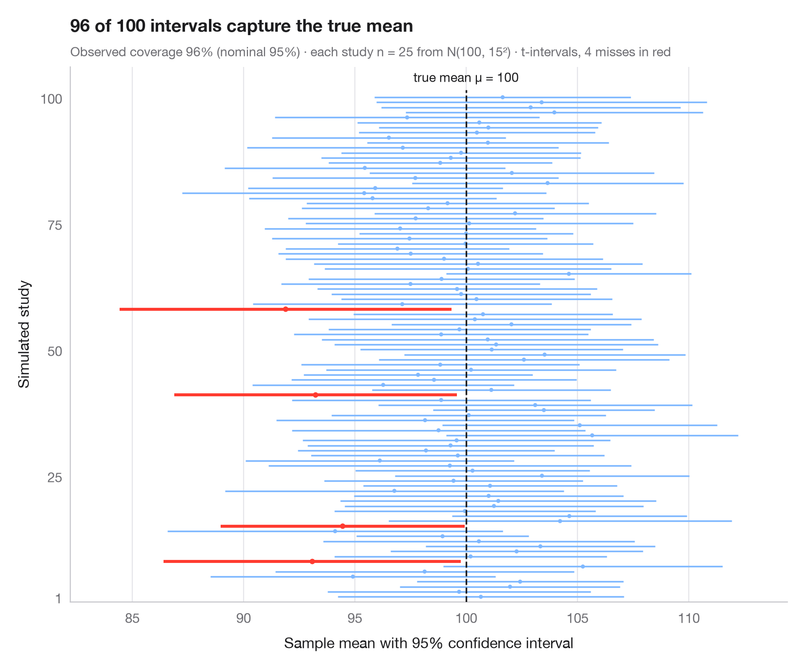

# What a 95% confidence interval means

> 100 simulated 95% CIs for a mean; the ones that miss the true value are in red.



"95% confidence" is a property of the *procedure*, not of one interval. Here
the same study — a sample of 25 from a population with known mean 100 — is
repeated 100 times, and each horizontal line is the resulting 95% t-interval
around the sample mean. About 95 of them cover the true mean (dashed line);
the few that miss it are drawn in red. Interval widths vary too, because each
sample estimates its own standard deviation.

The data are simulated with `numpy` (seeded, normal population, μ = 100,
σ = 15) and the intervals use `scipy.stats.t.interval`.

**R equivalent:** `teaching classic (e.g. TeachingDemos::ci.examp())`  
**Libraries:** Matplotlib, NumPy, SciPy

```python
import matplotlib.pyplot as plt
import numpy as np
from scipy import stats

# Simulate 100 studies of n = 25 from N(100, 15²)
rng = np.random.default_rng(2024)
mu, sigma, n, reps = 100, 15, 25, 100
samples = rng.normal(mu, sigma, size=(reps, n))
means = samples.mean(axis=1)
se = samples.std(axis=1, ddof=1) / np.sqrt(n)
lo, hi = stats.t.interval(0.95, df=n - 1, loc=means, scale=se)
miss = (lo > mu) | (hi < mu)

fig, ax = plt.subplots(figsize=(8, 6.6))
y = np.arange(1, reps + 1)
colors = np.where(miss, "#FF3B30", "#7FB8FF")
ax.hlines(y, lo, hi, color=colors, lw=np.where(miss, 2.2, 1.2))
ax.scatter(means, y, s=np.where(miss, 16, 9), color=colors, zorder=3, lw=0)
ax.vlines(mu, 0, reps + 1.5, color="#1D1D1F", ls="--", lw=1.2, zorder=4)
ax.text(mu, reps + 2.5, "true mean μ = 100", ha="center", va="bottom", fontsize=9.5,
        color="#1D1D1F")

ax.set_ylim(0, reps + 6)
ax.set_yticks([1, 25, 50, 75, 100])
ax.set_ylabel("Simulated study")
ax.set_xlabel("Sample mean with 95% confidence interval")
ax.grid(axis="y", visible=False); ax.grid(axis="x")
ax.margins(x=0.08)
ax.set_title(f"{reps - miss.sum()} of {reps} intervals capture the true mean", pad=26)
ax.text(0, 1.02, f"Observed coverage {100 * (1 - miss.mean()):.0f}% (nominal 95%) · "
        f"each study n = {n} from N({mu}, {sigma}²) · t-intervals, {miss.sum()} misses in red",
        transform=ax.transAxes, fontsize=9.5, color="#6E6E73")
plt.show()
```

[View on the Statlas website →](https://warint.github.io/statlas/inference-uncertainty/confidence-intervals/) · [← Inference & uncertainty](../README.md)
