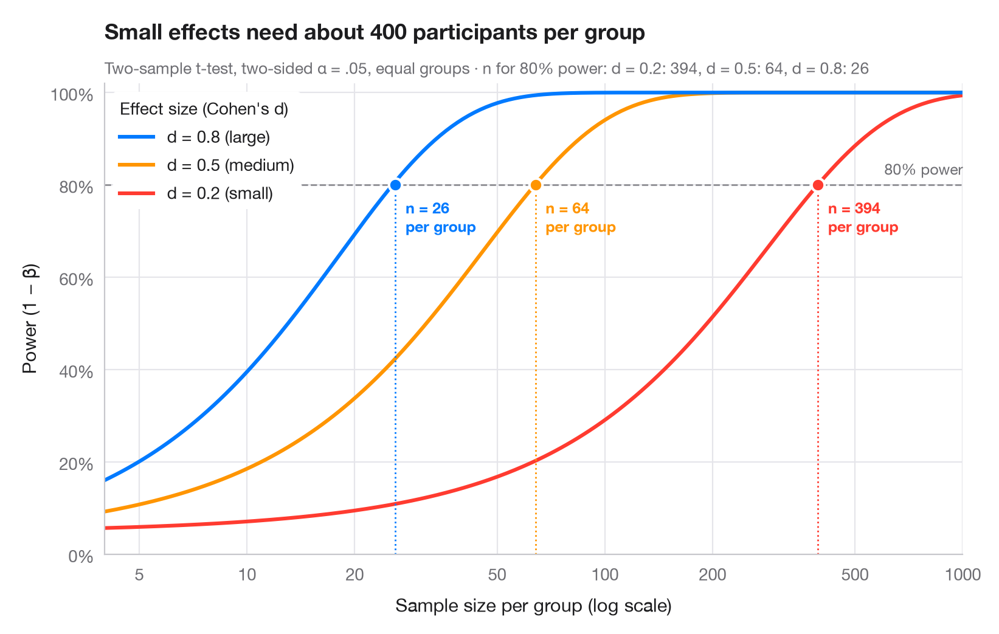

# Power curve

> Power of a two-sample t-test against sample size for small, medium and large effects.



Statistical power is the probability that a study detects an effect that is
really there. Each curve shows how power grows with the number of
participants per group, for one of Cohen's benchmark effect sizes (small
d = 0.2, medium 0.5, large 0.8). Where a curve crosses the conventional 80%
line, a dot marks the sample size needed — note how quickly it explodes as
the effect shrinks (the x-axis is logarithmic).

Computed with `statsmodels.stats.power.TTestIndPower`: `.power()` for the
curves and `.solve_power()` for the required n (two-sided α = .05, equal
group sizes).

**R equivalent:** `pwr::pwr.t.test() + plot()`  
**Libraries:** Matplotlib, NumPy, statsmodels

```python
import matplotlib.pyplot as plt
import numpy as np
from matplotlib.ticker import FixedLocator, NullLocator
from statsmodels.stats.power import TTestIndPower

analysis = TTestIndPower()
n = np.geomspace(4, 1000, 300)  # participants per group
effects = {0.2: ("small", "#FF3B30"), 0.5: ("medium", "#FF9500"), 0.8: ("large", "#007AFF")}

fig, ax = plt.subplots(figsize=(8, 5))
ax.axhline(0.8, color="#8E8E93", ls="--", lw=1)
ax.text(1000, 0.815, "80% power", ha="right", va="bottom", fontsize=9, color="#6E6E73")

required = {}
for d, (name, c) in effects.items():
    power = analysis.power(effect_size=d, nobs1=n, alpha=0.05)
    power = np.nan_to_num(power, nan=1.0)  # the noncentral t returns NaN once power ≈ 1
    ax.plot(n, power, color=c, lw=2.2,
            label=f"d = {d} ({name})")
    # Sample size per group that reaches 80% power
    n80 = int(np.ceil(analysis.solve_power(effect_size=d, power=0.8, alpha=0.05)))
    required[d] = n80
    ax.vlines(n80, 0, 0.8, color=c, lw=1, ls=":")
    ax.scatter(n80, 0.8, s=60, color=c, edgecolor="white", lw=1.5, zorder=4)
    ax.annotate(f"n = {n80}\nper group", (n80, 0.8), xytext=(6, -8), textcoords="offset points",
                ha="left", va="top", fontsize=9, color=c, fontweight="semibold")

handles, labels = ax.get_legend_handles_labels()
ax.legend(handles[::-1], labels[::-1], loc="upper left", title="Effect size (Cohen's d)",
          alignment="left", frameon=True, facecolor="white", edgecolor="none", framealpha=1)
ax.set_xscale("log")
ax.xaxis.set_major_locator(FixedLocator([5, 10, 20, 50, 100, 200, 500, 1000]))
ax.xaxis.set_minor_locator(NullLocator())
ax.xaxis.set_major_formatter(lambda v, _: f"{v:g}")
ax.set_xlim(4, 1000)
ax.set_ylim(0, 1.02)
ax.yaxis.set_major_formatter(lambda v, _: f"{v:.0%}")
ax.grid(axis="x")
ax.set_xlabel("Sample size per group (log scale)")
ax.set_ylabel("Power (1 − β)")
ax.set_title("Small effects need about 400 participants per group", pad=26)
ax.text(0, 1.02, "Two-sample t-test, two-sided α = .05, equal groups · n for 80% power: "
        + ", ".join(f"d = {d}: {k}" for d, k in required.items()),
        transform=ax.transAxes, fontsize=9.5, color="#6E6E73")
plt.show()
```

---

**Statlas** by [Thierry Warin](https://www.warin.ca) · [View on the website →](https://warint.github.io/statlas/inference-uncertainty/power-curve/) · [← Inference & uncertainty](../README.md)

**Cite:** Warin, T. (2026). Power curve. In Statlas: The Python Gallery of Statistical Graphics. https://warint.github.io/statlas/inference-uncertainty/power-curve/
