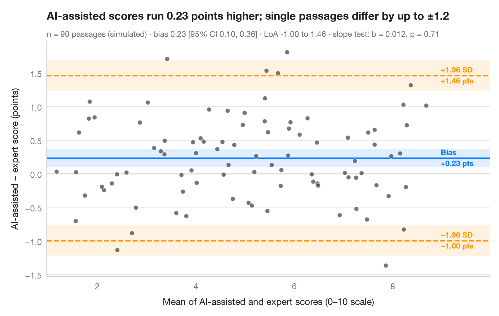

# Bland–Altman plot

> Do two coders place party manifestos on the left–right scale the same way? Bias and 95% limits of agreement.



When two instruments — or two coders — measure the same thing, a high
correlation says nothing about whether they **agree**. The Bland–Altman plot puts the difference
between methods on the y-axis and their average on the x-axis. The middle
line is the mean difference (systematic bias), the outer lines the 95%
**limits of agreement** (bias ± 1.96 SD) within which most disagreements
fall. Shaded bands are the 95% confidence intervals of these three lines,
using the Bland & Altman (1986) standard errors; a slope in the cloud would
signal a proportional bias.

Data are **simulated** with `numpy` (seeded) to mimic a classic
content-analysis check: two trained coders each place the same 80 party
manifestos on a 0–10 left–right scale, and coder B is built to sit about 0.4
points to the right of coder A. Bias and intervals use `scipy.stats.t`; the
slope test is an OLS fit from **statsmodels**.

**R equivalent:** `BlandAltmanLeh::bland.altman.plot() / blandr::blandr.draw()`  
**Libraries:** Matplotlib, NumPy, statsmodels, SciPy

**Data:** Simulated data with a fixed random seed, created for this example. — No real respondents, documents or measurements: the numbers only illustrate how the chart and its statistics work.


```python
import matplotlib.pyplot as plt
import numpy as np
import statsmodels.api as sm
from scipy import stats

# Simulated coding: 80 manifestos placed on a 0–10 left–right scale by two coders;
# coder B leans ~0.4 points to the right and is a little noisier
rng = np.random.default_rng(11)
n = 80
position = rng.uniform(1.5, 8.5, n)
coder_a = position + rng.normal(0, 0.35, n)
coder_b = position + 0.4 + rng.normal(0, 0.45, n)

mean, diff = (coder_a + coder_b) / 2, coder_b - coder_a
bias, sd = diff.mean(), diff.std(ddof=1)
loa = bias + np.array([-1.96, 1.96]) * sd
t = stats.t.ppf(0.975, n - 1)
ci_bias = t * sd / np.sqrt(n)            # half-width of the CI for the bias
ci_loa = t * np.sqrt(3 * sd**2 / n)      # Bland & Altman (1986) SE of a limit
slope = sm.OLS(diff, sm.add_constant(mean)).fit()

fig, ax = plt.subplots(figsize=(8, 5))
for y0, hw, c in [(bias, ci_bias, "#007AFF"), (loa[0], ci_loa, "#FF9500"), (loa[1], ci_loa, "#FF9500")]:
    ax.axhspan(y0 - hw, y0 + hw, color=c, alpha=0.12, lw=0)
    ax.axhline(y0, color=c, lw=1.6, ls="-" if c == "#007AFF" else "--")
ax.axhline(0, color="#8E8E93", lw=0.8)
ax.scatter(mean, diff, s=30, color="#3A3A3C", alpha=0.7, edgecolor="white", lw=0.6, zorder=3)

# Labels on the right margin
x_lab = mean.max() + 0.3
for y0, name, c in [(loa[1], "+1.96 SD", "#FF9500"), (bias, "Bias", "#007AFF"),
                    (loa[0], "−1.96 SD", "#FF9500")]:
    ax.text(x_lab, y0, f"{name}\n{y0:+.2f} pts".replace("-", "−"), va="center", ha="left", fontsize=9,
            color=c, fontweight="semibold", linespacing=1.3)

ax.set_xlim(mean.min() - 0.2, mean.max() + 1.3)
ax.set_xlabel("Mean left–right position of the two coders (0–10 scale)")
ax.set_ylabel("Coder B − coder A (points)")
ax.set_title(f"Coder B sits {bias:.2f} points further right; single codings differ "
             f"by up to ±{1.96 * sd:.1f}", pad=26)
ax.text(0, 1.02, f"Simulated · n = {n} manifestos · bias {bias:.2f} [95% CI {bias - ci_bias:.2f}, "
        f"{bias + ci_bias:.2f}] · LoA {loa[0]:.2f} to {loa[1]:.2f} · proportional bias: slope = {slope.params[1]:.3f}, "
        f"p = {slope.pvalues[1]:.2f}", transform=ax.transAxes, fontsize=9.5, color="#6E6E73")
plt.show()
```

---

**PyStatlas** by [Thierry Warin](https://www.warin.ca) · [View on the website →](https://warint.github.io/pystatlas/inference-uncertainty/bland-altman/) · [← Inference & uncertainty](../README.md)

**Cite:** Warin, T. (2026). Bland–Altman plot. In PyStatlas: The Python Gallery of Statistical Graphics for the Social Sciences. https://warint.github.io/pystatlas/inference-uncertainty/bland-altman/
