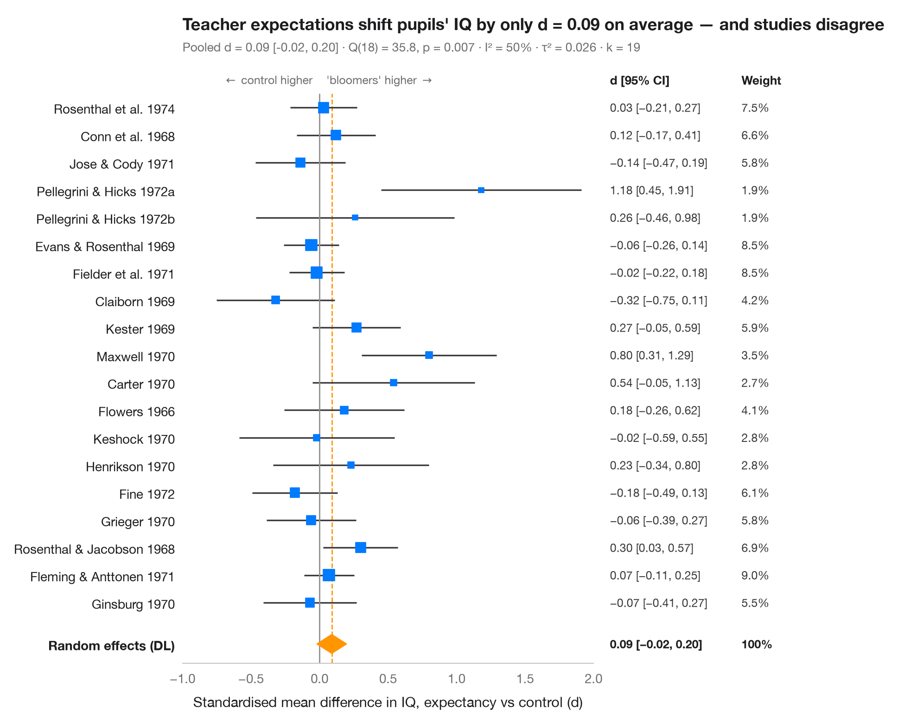

# Meta-analysis forest plot

> Study risk ratios with CIs, random-effects pooled diamond and heterogeneity statistics.



A forest plot lays out every study of a meta-analysis on one line: the square
is the study's estimate (its area proportional to the study's weight), the
whisker its 95% confidence interval. The diamond at the bottom is the pooled
**random-effects** estimate (DerSimonian–Laird), whose width is its 95% CI.
The subtitle reports heterogeneity — Cochran's Q, I² (share of variability
due to real between-study differences) and τ² (their variance).

Data are the 13 classic BCG-vaccine trials against tuberculosis (Colditz et
al., 1994; `dat.bcg` in R's **metafor**), typed in as counts. Log risk ratios
come from `effectsize_2proportions` and pooling from `combine_effects` in
`statsmodels.stats.meta_analysis`.

**R equivalent:** `meta::forest() / metafor::forest()`  
**Libraries:** Matplotlib, NumPy, pandas, SciPy, statsmodels

```python
import matplotlib.pyplot as plt
import numpy as np
import pandas as pd
from matplotlib.transforms import blended_transform_factory
from scipy import stats
from statsmodels.stats.meta_analysis import combine_effects, effectsize_2proportions

# BCG trials: TB cases / no TB in vaccinated (t) and control (c) arms
bcg = pd.DataFrame({
    "study": ["Aronson 1948", "Ferguson & Simes 1949", "Rosenthal 1960", "Hart & Sutherland 1977",
              "Frimodt-Moller 1973", "Stein & Aronson 1953", "Vandiviere 1973", "TPT Madras 1980",
              "Coetzee & Berjak 1968", "Rosenthal 1961", "Comstock 1974", "Comstock & Webster 1969",
              "Comstock 1976"],
    "tpos": [4, 6, 3, 62, 33, 180, 8, 505, 29, 17, 186, 5, 27],
    "tneg": [119, 300, 228, 13536, 5036, 1361, 2537, 87886, 7470, 1699, 50448, 2493, 16886],
    "cpos": [11, 29, 11, 248, 47, 372, 10, 499, 45, 65, 141, 3, 29],
    "cneg": [128, 274, 209, 12619, 5761, 1079, 619, 87892, 7232, 1600, 27197, 2338, 17825]})
eff, var = effectsize_2proportions(bcg.tpos, bcg.tpos + bcg.tneg, bcg.cpos, bcg.cpos + bcg.cneg,
                                   statistic="risk-ratio")
res = combine_effects(eff, var, method_re="dl", row_names=bcg.study)
tab = res.summary_frame()
studies, pooled = tab.iloc[:len(bcg)], tab.loc["random effect"]
q_p = stats.chi2.sf(res.q, res.df_resid)

fig, ax = plt.subplots(figsize=(8, 6.2))
y = np.arange(len(bcg), 0, -1) + 1.0
ax.hlines(y, np.exp(studies.ci_low), np.exp(studies.ci_upp), color="#3A3A3C", lw=1.2)
ax.scatter(np.exp(studies.eff), y, marker="s", s=900 * studies.w_re, color="#007AFF", zorder=3)

# Pooled random-effects diamond
lo, mid, hi = np.exp([pooled.ci_low, pooled.eff, pooled.ci_upp])
ax.fill([lo, mid, hi, mid], [0.5, 0.85, 0.5, 0.15], color="#FF9500", zorder=3)
ax.vlines(1, -0.2, len(bcg) + 1.5, color="#8E8E93", lw=1)
ax.vlines(mid, -0.2, len(bcg) + 1.5, color="#FF9500", lw=1, ls="--", zorder=1)

# Table columns to the right of the plot: RR [95% CI] and weight
tr = blended_transform_factory(ax.transAxes, ax.transData)
for x, head in [(1.04, "RR [95% CI]"), (1.36, "Weight")]:
    ax.text(x, len(bcg) + 2, head, transform=tr, fontsize=9.5, fontweight="semibold", va="center")
for yi, (_, r) in zip(y, studies.iterrows()):
    ax.text(1.04, yi, f"{np.exp(r.eff):.2f} [{np.exp(r.ci_low):.2f}, {np.exp(r.ci_upp):.2f}]",
            transform=tr, fontsize=9, va="center", color="#3A3A3C")
    ax.text(1.36, yi, f"{100 * r.w_re:.1f}%", transform=tr, fontsize=9, va="center", color="#3A3A3C")
for x, txt in [(1.04, f"{mid:.2f} [{lo:.2f}, {hi:.2f}]"), (1.36, "100%")]:
    ax.text(x, 0.5, txt, transform=tr, fontsize=9, va="center", fontweight="semibold")

ax.set_xscale("log")
ax.set_xticks([0.05, 0.1, 0.25, 0.5, 1, 2, 4], ["0.05", "0.1", "0.25", "0.5", "1", "2", "4"])
ax.minorticks_off(); ax.set_xlim(0.05, 8)
ax.set_yticks(list(y) + [0.5], list(bcg.study) + ["Random effects (DL)"])
ax.get_yticklabels()[-1].set_fontweight("semibold")
ax.set_ylim(-0.2, len(bcg) + 2.6)
ax.grid(False); ax.spines["left"].set_visible(False)
ax.set_xlabel("Risk ratio of TB, vaccinated vs control (log scale)")
ax.text(0.9, len(bcg) + 2, r"$\leftarrow$ favours BCG", ha="right", va="center", fontsize=9, color="#6E6E73")
ax.text(1.1, len(bcg) + 2, r"favours control $\rightarrow$", ha="left", va="center", fontsize=9, color="#6E6E73")
ax.tick_params(axis="y", labelcolor="#1D1D1F")
ax.set_title("BCG vaccination halves tuberculosis risk — but trials disagree", pad=26)
ax.text(0, 1.02, f"Pooled RR = {mid:.2f} [{lo:.2f}, {hi:.2f}] · Q({res.df_resid:.0f}) = "
        f"{res.q:.1f}, p < .001 · I² = {100 * res.i2:.0f}% · τ² = {res.tau2:.3f} · k = {len(bcg)}",
        transform=ax.transAxes, fontsize=9.5, color="#6E6E73")
plt.show()
```

---

**Statlas** by [Thierry Warin](https://www.warin.ca) · [View on the website →](https://warint.github.io/statlas/inference-uncertainty/meta-analysis-forest/) · [← Inference & uncertainty](../README.md)

**Cite:** Warin, T. (2026). Meta-analysis forest plot. In Statlas: The Python Gallery of Statistical Graphics. https://warint.github.io/statlas/inference-uncertainty/meta-analysis-forest/
