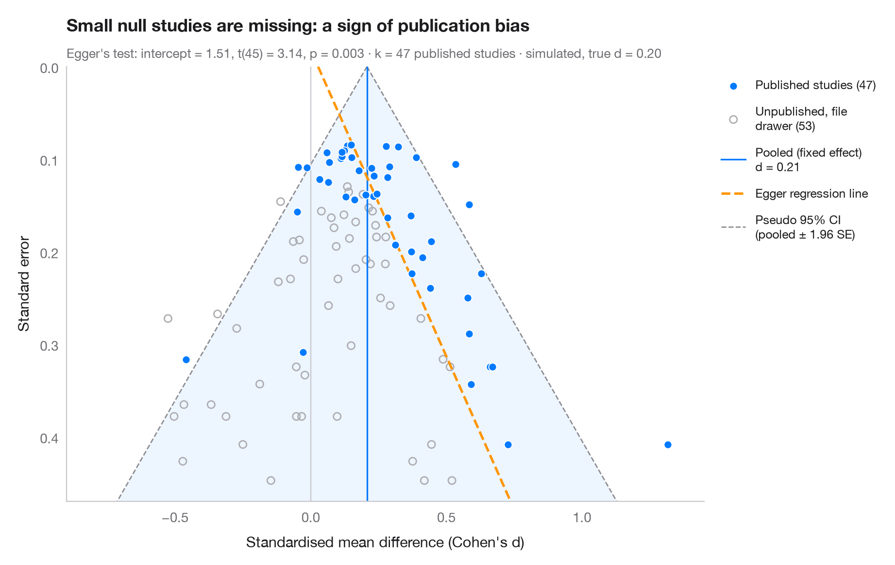

# Funnel plot

> Are small "Pygmalion" studies more optimistic? 19 teacher-expectancy effects against their standard error, with a pseudo 95% funnel and Egger's test.



Each dot is a study: its effect size on the x-axis, its standard error on the
(inverted) y-axis, so large precise studies sit at the top. Without bias the
dots form a symmetric funnel around the pooled effect, 95% of them inside the
pseudo-confidence region (± 1.96 SE). If small studies with null or negative
results are missing — publication bias — the bottom of the funnel is lopsided.
**Egger's regression test** (standard normal deviate on precision) quantifies
that asymmetry; its fitted line is dashed.

Data are the 19 teacher-expectancy ("Pygmalion") experiments of Raudenbush
(1984): standardised mean differences in pupils' IQ and their sampling
variances, typed in as published in `dat.raudenbush1985` of R's **metafor**.
The least precise studies report the largest effects, and Egger's intercept
is borderline. Asymmetry is not proof of publication bias: here the small
studies are mostly those in which teachers had known their pupils for a week
or less, which Raudenbush showed produces genuinely larger effects. Egger's
test is an OLS fit from **statsmodels**.

**R equivalent:** `metafor::funnel() + metafor::regtest()`  
**Libraries:** Matplotlib, NumPy, statsmodels

**Data:** Raudenbush, S. W. (1984). Magnitude of teacher expectancy effects on pupil IQ as a function of the credibility of expectancy induction: A synthesis of findings from 18 experiments. Journal of Educational Psychology, 76(1), 85–97. https://doi.org/10.1037/0022-0663.76.1.85 — Effect sizes and variances typed in from dat.raudenbush1985 in R's metadat/metafor (Viechtbauer, 2010, Journal of Statistical Software, 36(3), https://doi.org/10.18637/jss.v036.i03); one of the 18 experiments contributes two rows.


```python
import matplotlib.pyplot as plt
import numpy as np
import statsmodels.api as sm

# Teacher-expectancy experiments (Raudenbush, 1984): standardised mean difference
# in pupil IQ and its sampling variance, as in metafor's dat.raudenbush1985
dp = np.array([0.03, 0.12, -0.14, 1.18, 0.26, -0.06, -0.02, -0.32, 0.27, 0.80, 0.54, 0.18,
               -0.02, 0.23, -0.18, -0.06, 0.30, 0.07, -0.07])
vi = np.array([0.0156, 0.0216, 0.0279, 0.1391, 0.1362, 0.0106, 0.0106, 0.0484, 0.0269, 0.0630,
               0.0912, 0.0497, 0.0835, 0.0841, 0.0253, 0.0279, 0.0193, 0.0088, 0.0303])
sp = np.sqrt(vi)

# Fixed-effect pooled estimate and Egger's test: z = b0 + b1 · precision
w = 1 / sp**2
pooled = np.sum(w * dp) / w.sum()
egger = sm.OLS(dp / sp, sm.add_constant(1 / sp)).fit()
b0, b1 = egger.params

fig, ax = plt.subplots(figsize=(9, 5.6))
s_grid = np.linspace(0, sp.max() * 1.1, 100)
ax.fill_betweenx(s_grid, pooled - 1.96 * s_grid, pooled + 1.96 * s_grid, color="#007AFF",
                 alpha=0.07, lw=0)
for sign in (-1, 1):
    ax.plot(pooled + sign * 1.96 * s_grid, s_grid, color="#8E8E93", lw=1, ls="--",
            label="Pseudo 95% CI\n(pooled ± 1.96 SE)" if sign > 0 else None)
ax.axvline(pooled, color="#007AFF", lw=1.2, label=f"Pooled (fixed effect)\nd = {pooled:.2f}")
ax.axvline(0, color="#C7C7CC", lw=0.8)
ax.plot(b1 + b0 * s_grid, s_grid, color="#FF9500", lw=1.8, ls="--", label="Egger regression line")

ax.scatter(dp, sp, s=40, color="#007AFF", edgecolor="white", lw=0.7, zorder=3,
           label=f"Studies ({len(dp)})")

ax.invert_yaxis()
ax.set_ylim(sp.max() * 1.1, 0)
ax.set_xlim(-0.9, 1.4)
ax.set_xlabel("Standardised mean difference in IQ, expectancy vs control (d)")
ax.set_ylabel("Standard error")
ax.grid(axis="y", visible=False)

handles, labels = ax.get_legend_handles_labels()
order = [3, 1, 2, 0]
ax.legend([handles[i] for i in order], [labels[i] for i in order], loc="upper left",
          bbox_to_anchor=(1.01, 1), fontsize=9, labelspacing=1)

ax.set_title("Small studies report larger effects — " + ("Egger's test flags asymmetry"
             if egger.pvalues[0] < 0.05 else "but Egger's test is borderline"), pad=26)
ax.text(0, 1.02, f"Egger's test: intercept = {b0:.2f}, t({egger.df_resid:.0f}) = "
        f"{egger.tvalues[0]:.2f}, p = {egger.pvalues[0]:.3f} · k = {len(dp)} teacher-expectancy "
        f"studies (Raudenbush, 1984)", transform=ax.transAxes, fontsize=9.5, color="#6E6E73")
plt.show()
```

---

**PyStatlas** by [Thierry Warin](https://www.warin.ca) · [View on the website →](https://warint.github.io/pystatlas/inference-uncertainty/funnel-plot/) · [← Inference & uncertainty](../README.md)

**Cite:** Warin, T. (2026). Funnel plot. In PyStatlas: The Python Gallery of Statistical Graphics. https://warint.github.io/pystatlas/inference-uncertainty/funnel-plot/
