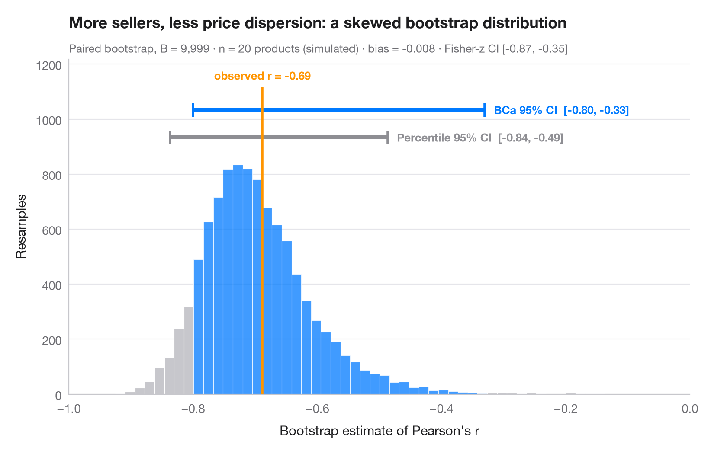
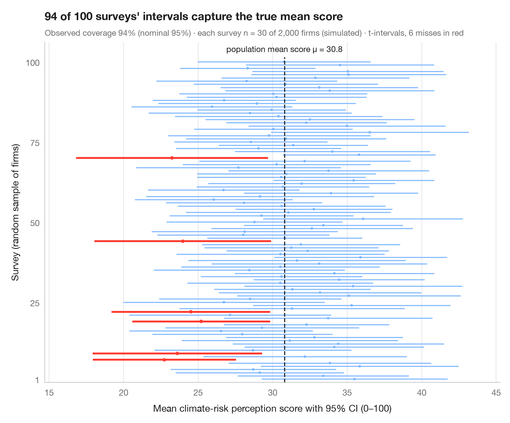
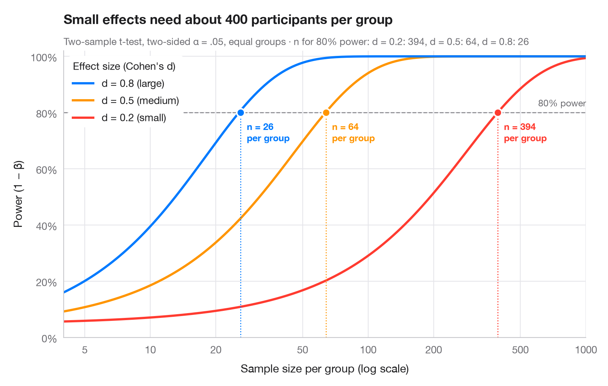
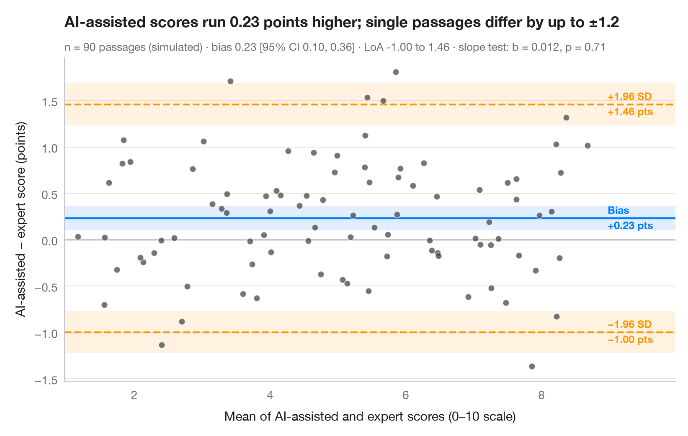
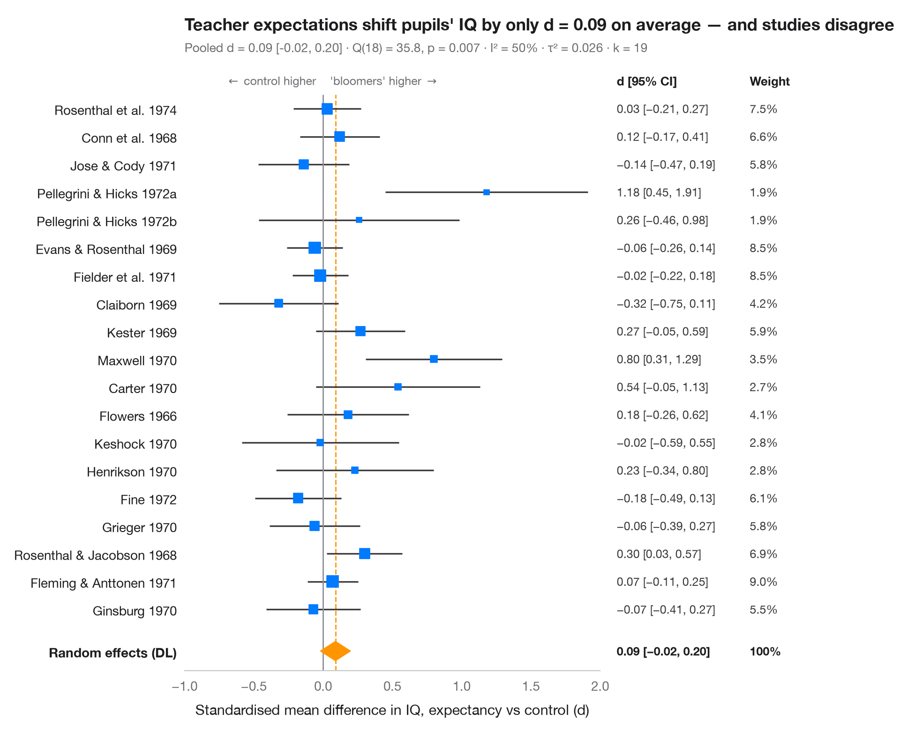
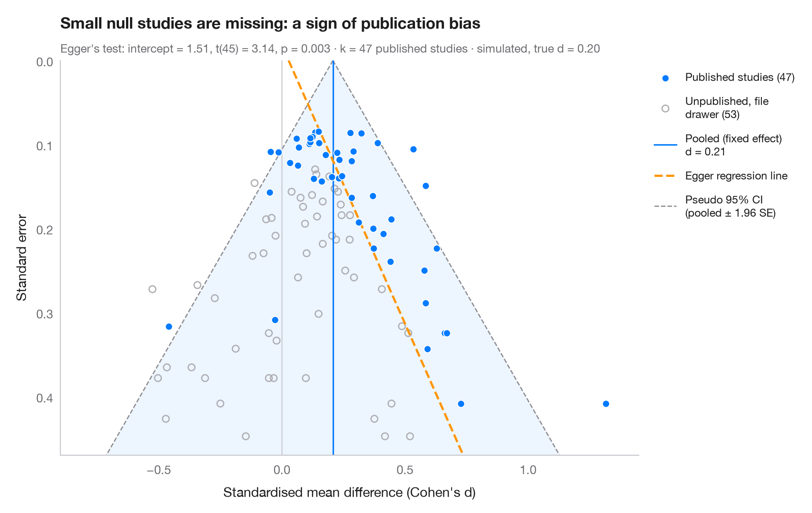

# Inference & uncertainty

Bootstrap, confidence intervals, power, agreement and meta-analysis forest plots.

| Chart | Description |
|:--|:--|
|  | **[Bootstrap distribution](01-bootstrap-distribution/)** Online sellers and price dispersion across 20 products — resampled correlation with percentile and BCa 95% CIs. `boot::boot() + boot::boot.ci()` |
|  | **[What a 95% confidence interval means](02-confidence-intervals/)** 100 surveys of 30 firms out of 2,000; the 95% CIs for the mean climate-risk score that miss are in red. `teaching classic (e.g. TeachingDemos::ci.examp())` |
|  | **[Power curve](03-power-curve/)** Power of a two-sample t-test against sample size for small, medium and large effects. `pwr::pwr.t.test() + plot()` |
|  | **[Bland–Altman plot](04-bland-altman/)** Do AI-assisted and expert scores of IPCC scenario passages agree? Bias and 95% limits of agreement. `BlandAltmanLeh::bland.altman.plot() / blandr::blandr.draw()` |
|  | **[Meta-analysis forest plot](05-meta-analysis-forest/)** Do teacher expectations raise pupils' IQ? 19 "Pygmalion" experiments, a random-effects pooled diamond and heterogeneity statistics. `meta::forest() / metafor::forest()` |
|  | **[Funnel plot](06-funnel-plot/)** Are small "Pygmalion" studies more optimistic? 19 teacher-expectancy effects against their standard error, with a pseudo 95% funnel and Egger's test. `metafor::funnel() + metafor::regtest()` |

[← All families](../../README.md) · [Browse on the website](https://warint.github.io/pystatlas/inference-uncertainty/)
