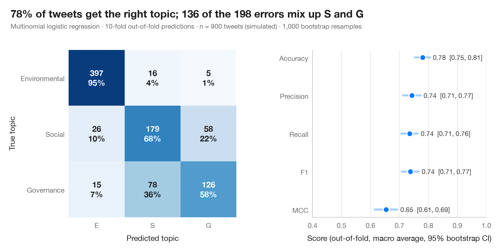

# Confusion matrix with metrics

> How well a classifier sorts tweets into Environmental, Social and Governance topics — out-of-fold 3 × 3 confusion matrix with bootstrap intervals for the metrics.



A confusion matrix crosses the true class with the predicted class. Each cell
shows a count and its share of the true class (the row), so the diagonal reads
directly as the recall of each class and the off-diagonal cells show which
classes the model mixes up. The predictions are **out-of-fold**: every
observation is predicted by a model that never saw it during a 10-fold
cross-validation, which is what the matrix would look like on new data.

The example is set in the context of Kouloukoui, de Marcellis-Warin, Gomes and
Warin (2023, *Journal of Cleaner Production*), who map Twitter conversations
about environmental, social and governance (ESG) topics with natural language
processing. The data are **simulated** for illustration and are *not* the
paper's data or results: n = 900 tweets, each described by counts of words
from six small topic lexicons (two per ESG pillar), with social and governance
vocabulary deliberately overlapping. The model is a standardised multinomial
logistic regression; predictions come from `cross_val_predict` and the
metrics (macro-averaged precision, recall and F1, accuracy, MCC, each with a
95% bootstrap interval) from `sklearn.metrics`.

**R equivalent:** `yardstick::conf_mat() + autoplot()`  
**Libraries:** Matplotlib, NumPy, scikit-learn

**Data:** Simulated data with a fixed random seed, created for this example. — No real respondents, documents or measurements: the numbers only illustrate how the chart and its statistics work.

**Data:** Kouloukoui, D., de Marcellis-Warin, N., Gomes, S. M. S., & Warin, T. (2023). Mapping global conversations on twitter about environmental, social, and governance topics through natural language processing. Journal of Cleaner Production, 414, 137369. https://doi.org/10.1016/j.jclepro.2023.137369 — The example is set in the context of this paper; unless its description says otherwise, the numbers are simulated and are not the paper's data or results.


```python
import matplotlib.pyplot as plt
import numpy as np
from sklearn.linear_model import LogisticRegression
from sklearn.metrics import (accuracy_score, confusion_matrix, f1_score, matthews_corrcoef,
                             precision_score, recall_score)
from sklearn.model_selection import StratifiedKFold, cross_val_predict
from sklearn.pipeline import make_pipeline
from sklearn.preprocessing import StandardScaler
# Simulated data, set in the context of Kouloukoui et al. (2023) [kouloukoui2023esg]

# Data: 900 tweets, true topic 0 = E, 1 = S, 2 = G; features = hits on six topic lexicons
rng = np.random.default_rng(2023)
labels = ["Environmental", "Social", "Governance"]
y = rng.choice(3, size=900, p=[0.45, 0.30, 0.25])
lam = np.array([[2.0, 1.6, 0.3, 0.3, 0.2, 0.2],     # expected lexicon hits for an E tweet
                [0.3, 0.3, 1.4, 1.0, 0.8, 0.6],     # S tweets borrow governance words ...
                [0.3, 0.2, 0.7, 0.6, 1.3, 1.1]])    # ... and G tweets social ones
X = np.log1p(rng.poisson(lam[y]))

# Out-of-fold predictions from a 10-fold cross-validation
model = make_pipeline(StandardScaler(), LogisticRegression(max_iter=1000))
cv = StratifiedKFold(n_splits=10, shuffle=True, random_state=0)
pred = cross_val_predict(model, X, y, cv=cv)
cm = confusion_matrix(y, pred)

# Metrics (macro-averaged over the three classes) with 95% bootstrap intervals
metrics = {"Accuracy": accuracy_score,
           "Precision": lambda a, b: precision_score(a, b, average="macro"),
           "Recall": lambda a, b: recall_score(a, b, average="macro"),
           "F1": lambda a, b: f1_score(a, b, average="macro"), "MCC": matthews_corrcoef}
boot = {k: [] for k in metrics}
for _ in range(1000):
    i = rng.integers(0, len(y), len(y))
    for k, f in metrics.items():
        boot[k].append(f(y[i], pred[i]))
point = {k: f(y, pred) for k, f in metrics.items()}
ci = {k: np.percentile(v, [2.5, 97.5]) for k, v in boot.items()}

plt.rcParams["figure.constrained_layout.use"] = False   # manual margins leave room for the subtitle
fig, (ax, axm) = plt.subplots(1, 2, figsize=(10, 5), gridspec_kw=dict(width_ratios=(1, 1)))
fig.subplots_adjust(left=0.13, right=0.97, top=0.80, bottom=0.13, wspace=0.42)

# Confusion matrix: colour = share of the true class
share = cm / cm.sum(axis=1, keepdims=True)
ax.imshow(share, cmap="Blues", vmin=0, vmax=1)
for r in range(3):
    for c in range(3):
        ax.text(c, r, f"{cm[r, c]}\n{share[r, c]:.0%}", ha="center", va="center", fontsize=11.5,
                fontweight="semibold", color="white" if share[r, c] > 0.5 else "#1d1d1f")
ax.set_xticks(range(3), ["E", "S", "G"])
ax.set_yticks(range(3), labels)
ax.set_xlabel("Predicted topic")
ax.set_ylabel("True topic")
ax.grid(False)
for s in ax.spines.values():
    s.set_visible(False)

# Metrics with intervals
names = list(metrics)[::-1]
for j, k in enumerate(names):
    axm.plot(ci[k], [j, j], color="#007AFF", lw=3, solid_capstyle="round", alpha=0.35)
    axm.scatter(point[k], j, s=70, color="#007AFF", zorder=3, edgecolor="white", lw=1.5)
    axm.text(ci[k][1] + 0.01, j, f"{point[k]:.2f}  [{ci[k][0]:.2f}, {ci[k][1]:.2f}]",
             va="center", fontsize=9.5, color="#3A3A3C")
axm.set_yticks(range(len(names)), names)
axm.set_xlim(0.4, 1.0)
axm.set_xlabel("Score (out-of-fold, macro average, 95% bootstrap CI)")
axm.grid(axis="x"); axm.grid(axis="y", visible=False)

sg = cm[1, 2] + cm[2, 1]
fig.suptitle(f"{point['Accuracy']:.0%} of tweets get the right topic; {sg} of the "
             f"{len(y) - np.trace(cm)} errors mix up S and G", x=0.02, y=0.97, ha="left")
fig.text(0.02, 0.885, f"Multinomial logistic regression · 10-fold out-of-fold predictions · n = {len(y)} "
         "tweets (simulated) · 1,000 bootstrap resamples", fontsize=9.5, color="#6E6E73")
plt.show()
```

---

**PyStatlas** by [Thierry Warin](https://www.warin.ca) · [View on the website →](https://warint.github.io/pystatlas/machine-learning/confusion-matrix/) · [← Machine learning](../README.md)

**Cite:** Warin, T. (2026). Confusion matrix with metrics. In PyStatlas: A Python Gallery of Statistical Graphics for the Social Sciences. https://warint.github.io/pystatlas/machine-learning/confusion-matrix/
