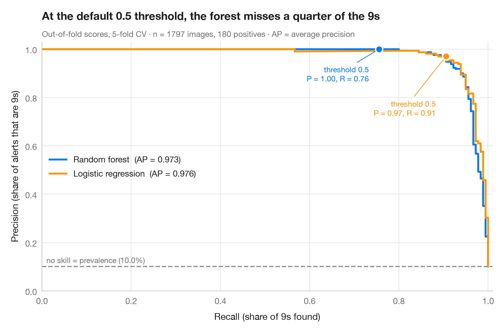

# Precision–recall curves

> Out-of-fold precision–recall curves for two classifiers, with average precision and the no-skill baseline.



When the positive class is rare, a ROC curve can look excellent while most
alarms are false. The precision–recall curve answers the operational question
instead: if I want to catch this share of positives (**recall**), how many of
my alerts will be right (**precision**)? Each point is one decision threshold.
The dashed line is the no-skill baseline — the prevalence of the positive
class — and the area under each curve is summarised by the **average
precision** (AP).

Data are the 1,797 handwritten digits bundled with **scikit-learn**, recast as
a rare-event problem: detect the digit 9 (about 10% of images). Scores are
out-of-fold probabilities from a 5-fold cross-validation
(`cross_val_predict(method="predict_proba")`); curves and AP come from
`precision_recall_curve` and `average_precision_score`. The marker shows the
default 0.5 threshold on each curve.

**R equivalent:** `yardstick::pr_curve() + autoplot()`  
**Libraries:** Matplotlib, NumPy, scikit-learn

```python
import matplotlib.pyplot as plt
import numpy as np
from sklearn.datasets import load_digits
from sklearn.ensemble import RandomForestClassifier
from sklearn.linear_model import LogisticRegression
from sklearn.metrics import average_precision_score, precision_recall_curve
from sklearn.model_selection import StratifiedKFold, cross_val_predict
from sklearn.pipeline import make_pipeline
from sklearn.preprocessing import StandardScaler

# Data: is this handwritten digit a 9? (a ~10% minority class)
X, digit = load_digits(return_X_y=True)
y = (digit == 9).astype(int)
prevalence = y.mean()

models = {
    "Random forest": RandomForestClassifier(n_estimators=300, random_state=0),
    "Logistic regression": make_pipeline(StandardScaler(), LogisticRegression(max_iter=2000)),
}
palette = ["#007AFF", "#FF9500"]
cv = StratifiedKFold(n_splits=5, shuffle=True, random_state=0)

fig, ax = plt.subplots(figsize=(8, 5.2))
for (name, model), c in zip(models.items(), palette):
    score = cross_val_predict(model, X, y, cv=cv, method="predict_proba")[:, 1]
    prec, rec, thr = precision_recall_curve(y, score)
    ap = average_precision_score(y, score)
    ax.step(rec, prec, where="post", color=c, lw=2.2, label=f"{name}  (AP = {ap:.3f})")
    k = np.argmin(np.abs(thr - 0.5))  # the default threshold
    ax.scatter(rec[k], prec[k], s=70, color=c, edgecolor="white", lw=1.5, zorder=4)
    ax.annotate(f"threshold 0.5\nP = {prec[k]:.2f}, R = {rec[k]:.2f}", (rec[k], prec[k]),
                xytext=(-12, -38 if c == palette[0] else -70), textcoords="offset points",
                ha="right", fontsize=9, color=c,
                arrowprops=dict(arrowstyle="-", color=c, lw=0.8))

ax.axhline(prevalence, color="#8E8E93", ls="--", lw=1.4)
ax.text(0.01, prevalence + 0.015, f"no skill = prevalence ({prevalence:.1%})", fontsize=9, color="#6E6E73")
ax.set_xlim(0, 1.01)
ax.set_ylim(0, 1.03)
ax.set_xlabel("Recall (share of 9s found)")
ax.set_ylabel("Precision (share of alerts that are 9s)")
ax.grid(axis="x")
ax.legend(loc="center left")
ax.set_title("At the default 0.5 threshold, the forest misses a quarter of the 9s", pad=26)
ax.text(0, 1.02, f"Out-of-fold scores, 5-fold CV · n = {len(y)} images, {y.sum()} positives · "
        "AP = average precision", transform=ax.transAxes, fontsize=9.5, color="#6E6E73")
plt.show()
```

---

**PyStatlas** by [Thierry Warin](https://www.warin.ca) · [View on the website →](https://warint.github.io/pystatlas/machine-learning/precision-recall/) · [← Machine learning](../README.md)

**Cite:** Warin, T. (2026). Precision–recall curves. In PyStatlas: The Python Gallery of Statistical Graphics. https://warint.github.io/pystatlas/machine-learning/precision-recall/
