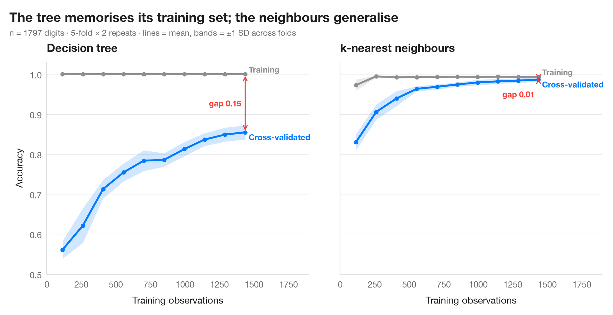

# Learning curve

> Training and cross-validated accuracy as the training set grows, for two models predicting which Facebook users share COVID-19 fake news.



A learning curve answers two questions before anyone collects more data: is
the model **overfitting** (a wide gap between the training score and the
cross-validated score) or **underfitting** (both scores low and close), and
would more observations still help (is the validation curve still rising)?
Lines are means over the folds of a repeated cross-validation; bands are
±1 standard deviation, so the width shows how much the estimate would move
with another split.

Two models are compared on the same task: a deep decision tree, which
memorises its training set, and a standardised logistic regression. The
example is set in the context of Melchior, Warin and Oliveira (2025,
*Technological Forecasting and Social Change*) on the sharing of COVID-19 fake
news on Facebook. The data are **simulated** for illustration and are *not*
the paper's data or results: n = 3,000 users, about one in eight of whom
shared a fake-news post, described by age, time on Facebook, COVID-19 groups
joined, trust in mainstream media, conspiracy beliefs and the share of friends
who shared fake news. The curves come from
`sklearn.model_selection.learning_curve` with a 5 × 2 repeated stratified
split. The dashed line is the majority-class baseline: with a rare class,
accuracy must be read against it, and here the logistic regression barely
beats it: more users would not help; better predictors would.

**R equivalent:** `caret::learning_curve_dat() + ggplot()`  
**Libraries:** Matplotlib, NumPy, pandas, scikit-learn

**Data:** Simulated data with a fixed random seed, created for this example. — No real respondents, documents or measurements: the numbers only illustrate how the chart and its statistics work.

**Data:** Melchior, C., Warin, T., & Oliveira, M. (2025). An investigation of the COVID-19-related fake news sharing on Facebook using a mixed methods approach. Technological Forecasting and Social Change, 213, 123969. https://doi.org/10.1016/j.techfore.2024.123969 — The example is set in the context of this paper; unless its description says otherwise, the numbers are simulated and are not the paper's data or results.


```python
import matplotlib.pyplot as plt
import numpy as np
import pandas as pd
from sklearn.linear_model import LogisticRegression
from sklearn.model_selection import RepeatedStratifiedKFold, learning_curve
from sklearn.pipeline import make_pipeline
from sklearn.preprocessing import StandardScaler
from sklearn.tree import DecisionTreeClassifier
# Simulated data, set in the context of Melchior, Warin & Oliveira (2025) [melchior2025fake]

# Data: 3,000 Facebook users; 1 = shared a COVID-19 fake-news post (a minority class)
rng = np.random.default_rng(2024)
n = 3000
X = pd.DataFrame({"age": rng.integers(18, 80, n),            # years
                  "hours": rng.gamma(2, 0.9, n),             # daily hours on Facebook
                  "groups": rng.poisson(3, n),               # COVID-19 groups joined
                  "trust_media": rng.integers(1, 8, n),      # 1-7 scale
                  "conspiracy": rng.integers(1, 8, n),       # 1-7 scale
                  "friends_shared": rng.beta(1, 8, n)})      # share of friends who shared
logit = (-4.3 + 0.025 * (X.age - 45) + 0.35 * X.hours + 0.15 * X.groups
         - 0.3 * (X.trust_media - 4) + 0.45 * (X.conspiracy - 4) + 6 * X.friends_shared)
y = (rng.random(n) < 1 / (1 + np.exp(-logit))).astype(int).to_numpy()
baseline = 1 - y.mean()

cv = RepeatedStratifiedKFold(n_splits=5, n_repeats=2, random_state=0)
sizes = np.linspace(0.08, 1.0, 10)
models = {"Decision tree": DecisionTreeClassifier(random_state=0),
          "Logistic regression": make_pipeline(StandardScaler(), LogisticRegression(max_iter=1000))}

plt.rcParams["figure.constrained_layout.use"] = False   # manual margins leave room for the subtitle
fig, axes = plt.subplots(1, 2, figsize=(10, 5), sharey=True)
fig.subplots_adjust(left=0.08, right=0.97, top=0.80, bottom=0.12, wspace=0.12)
for ax, (name, model) in zip(axes, models.items()):
    m_, train, valid = learning_curve(model, X, y, cv=cv, train_sizes=sizes, n_jobs=-1,
                                      shuffle=True, random_state=0)
    ax.axhline(baseline, color="#8E8E93", ls="--", lw=1)
    for scores, c, lab in [(train, "#8E8E93", "Training"), (valid, "#007AFF", "Cross-validated")]:
        m, s = scores.mean(axis=1), scores.std(axis=1)
        ax.fill_between(m_, m - s, m + s, color=c, alpha=0.18, lw=0)
        ax.plot(m_, m, color=c, lw=2.2, marker="o", ms=4)
        dy = 0.012 if lab == "Training" else -0.012
        ax.text(m_[-1] + 40, m[-1] + dy, lab, va="center", fontsize=9.5, color=c, fontweight="semibold")
    gap = train.mean(axis=1)[-1] - valid.mean(axis=1)[-1]
    ax.annotate("", xy=(m_[-1], valid.mean(axis=1)[-1]), xytext=(m_[-1], train.mean(axis=1)[-1]),
                arrowprops=dict(arrowstyle="<->", color="#FF3B30", lw=1.2))
    ax.text(m_[-1] - 50, valid.mean(axis=1)[-1] + (gap / 2 if gap > 0.05 else -0.04), f"gap {gap:.2f}",
            ha="right", va="center", fontsize=9.5, color="#FF3B30", fontweight="semibold")
    ax.set_title(name)
    ax.set_xlabel("Training observations")
    ax.set_xlim(0, m_[-1] * 1.32)
axes[0].text(60, baseline + 0.008, f"majority-class baseline {baseline:.2f}", fontsize=9, color="#6E6E73")
axes[0].set_ylabel("Accuracy")
axes[0].set_ylim(0.7, 1.02)

fig.suptitle("The tree memorises its training set; logistic regression plateaus just above the baseline",
             x=0.02, y=0.97, ha="left")
fig.text(0.02, 0.885, f"n = {n:,} users (simulated), {y.mean():.0%} shared fake news · "
         "5-fold × 2 repeats · lines = mean, bands = ±1 SD across folds",
         fontsize=9.5, color="#6E6E73")
plt.show()
```

---

**PyStatlas** by [Thierry Warin](https://www.warin.ca) · [View on the website →](https://warint.github.io/pystatlas/machine-learning/learning-curve/) · [← Machine learning](../README.md)

**Cite:** Warin, T. (2026). Learning curve. In PyStatlas: A Python Gallery of Statistical Graphics for the Social Sciences (Version 1.1.0) [Computer software]. https://warint.github.io/pystatlas/machine-learning/learning-curve/
