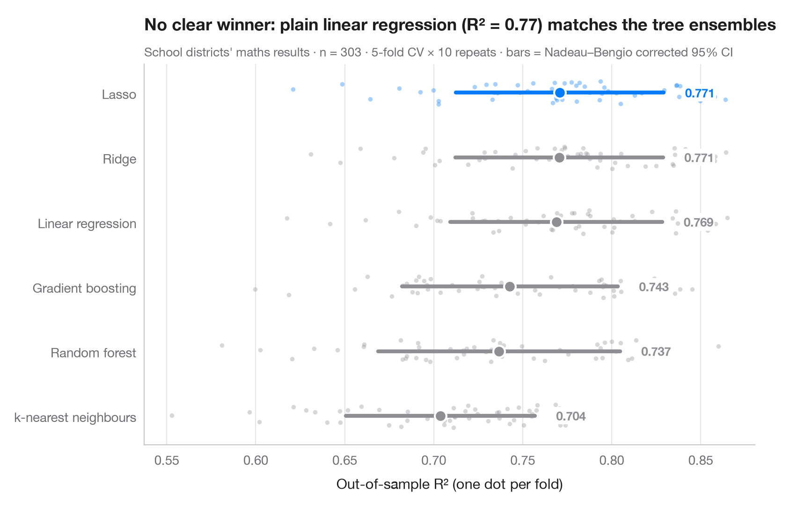

# Cross-validated model comparison

> Fold-by-fold R² of six models predicting California school districts' maths results, with means and corrected 95% intervals.



"Model B scores 0.47, model A 0.46" says nothing until we know how much the
score moves from one split to the next. Here every model is evaluated on the
**same** 10 × 5 repeated folds; each dot is one fold, the large marker is the
mean and the bar its 95% interval. Fold scores are not independent — the
training sets overlap — so the interval uses the **Nadeau–Bengio corrected**
variance rather than the naive standard error, which would be far too narrow.

Data are the 303 California school districts of the 1998 STAR test bundled
with **statsmodels** (`sm.datasets.star98`): the outcome is the share of
students scoring above the national median in maths, predicted from ten
district characteristics (share of low-income students, ethnic composition,
teacher experience and salary, spending per pupil, pupils per teacher,
college-prep enrolment, year-round schools). The score is the out-of-sample
R². Scores come from `cross_val_score` with `RepeatedKFold`; the linear models
are standardised in a `Pipeline`. Here plain linear regression does as well
as the tree ensembles: flexibility buys nothing when the relationship is close
to additive.

**R equivalent:** `caret::resamples() + bwplot() / tune::autoplot()`  
**Libraries:** Matplotlib, NumPy, SciPy, statsmodels, scikit-learn

```python
import matplotlib.pyplot as plt
import numpy as np
from scipy import stats
import statsmodels.api as sm
from sklearn.ensemble import GradientBoostingRegressor, RandomForestRegressor
from sklearn.linear_model import LassoCV, LinearRegression, RidgeCV
from sklearn.model_selection import RepeatedKFold, cross_val_score
from sklearn.neighbors import KNeighborsRegressor
from sklearn.pipeline import make_pipeline
from sklearn.preprocessing import StandardScaler

# Data: 303 California school districts; outcome = % of students above the national median in maths
d = sm.datasets.star98.load_pandas().data
y = 100 * d["NABOVE"] / (d["NABOVE"] + d["NBELOW"])
names = {"LOWINC": "% low-income students", "PERASIAN": "% Asian students", "PERBLACK": "% Black students",
         "PERHISP": "% Hispanic students", "AVYRSEXP": "Teacher experience (years)",
         "AVSALK": "Teacher salary ($000)", "PERSPENK": "Spending per pupil ($000)",
         "PTRATIO": "Pupils per teacher", "PCTAF": "% in college-prep courses",
         "PCTYRRND": "% year-round schools"}
X = d[list(names)]
k, reps = 5, 10
cv = RepeatedKFold(n_splits=k, n_repeats=reps, random_state=0)
models = {
    "Linear regression": make_pipeline(StandardScaler(), LinearRegression()),
    "Ridge": make_pipeline(StandardScaler(), RidgeCV(alphas=np.logspace(-3, 3, 25))),
    "Lasso": make_pipeline(StandardScaler(), LassoCV(random_state=0)),
    "Random forest": RandomForestRegressor(n_estimators=300, min_samples_leaf=5, random_state=0),
    "Gradient boosting": GradientBoostingRegressor(learning_rate=0.05, max_depth=2, random_state=0),
    "k-nearest neighbours": make_pipeline(StandardScaler(), KNeighborsRegressor(n_neighbors=15)),
}
scores = {name: cross_val_score(m, X, y, cv=cv, scoring="r2", n_jobs=-1) for name, m in models.items()}

# Nadeau–Bengio corrected 95% interval for a mean of k-fold scores
def corrected_ci(s):
    J = len(s)
    se = np.sqrt((1 / J + (1 / k) / (1 - 1 / k)) * s.var(ddof=1))
    t = stats.t.ppf(0.975, J - 1)
    return s.mean() - t * se, s.mean() + t * se

order = sorted(scores, key=lambda n: scores[n].mean())
best = order[-1]
fig, ax = plt.subplots(figsize=(8, 5.2))
rng = np.random.default_rng(3)
for i, name in enumerate(order):
    s = scores[name]
    c = "#007AFF" if name == best else "#8E8E93"
    ax.scatter(s, i + rng.uniform(-0.18, 0.18, len(s)), s=12, color=c, alpha=0.35, lw=0)
    lo, hi = corrected_ci(s)
    ax.plot([lo, hi], [i, i], color=c, lw=3, solid_capstyle="round")
    ax.scatter(s.mean(), i, s=80, color=c, edgecolor="white", lw=1.5, zorder=4)
    ax.text(hi + 0.012, i, f"{s.mean():.3f}", va="center", fontsize=9.5, color=c, fontweight="semibold",
            bbox=dict(fc="white", ec="none", pad=1), zorder=5)
ax.set_yticks(range(len(order)), order)
ax.set_xlabel("Out-of-sample R² (one dot per fold)")
ax.grid(axis="x"); ax.grid(axis="y", visible=False)
lin = scores["Linear regression"].mean()
ax.set_title(f"No clear winner: plain linear regression (R² = {lin:.2f}) matches the tree ensembles", pad=26)
ax.text(0, 1.02, f"School districts' maths results · n = {len(y)} · {k}-fold CV × {reps} repeats · "
        "bars = Nadeau–Bengio corrected 95% CI", transform=ax.transAxes, fontsize=9.5, color="#6E6E73")
plt.show()
```

---

**PyStatlas** by [Thierry Warin](https://www.warin.ca) · [View on the website →](https://warint.github.io/pystatlas/machine-learning/model-comparison/) · [← Machine learning](../README.md)

**Cite:** Warin, T. (2026). Cross-validated model comparison. In PyStatlas: The Python Gallery of Statistical Graphics. https://warint.github.io/pystatlas/machine-learning/model-comparison/
