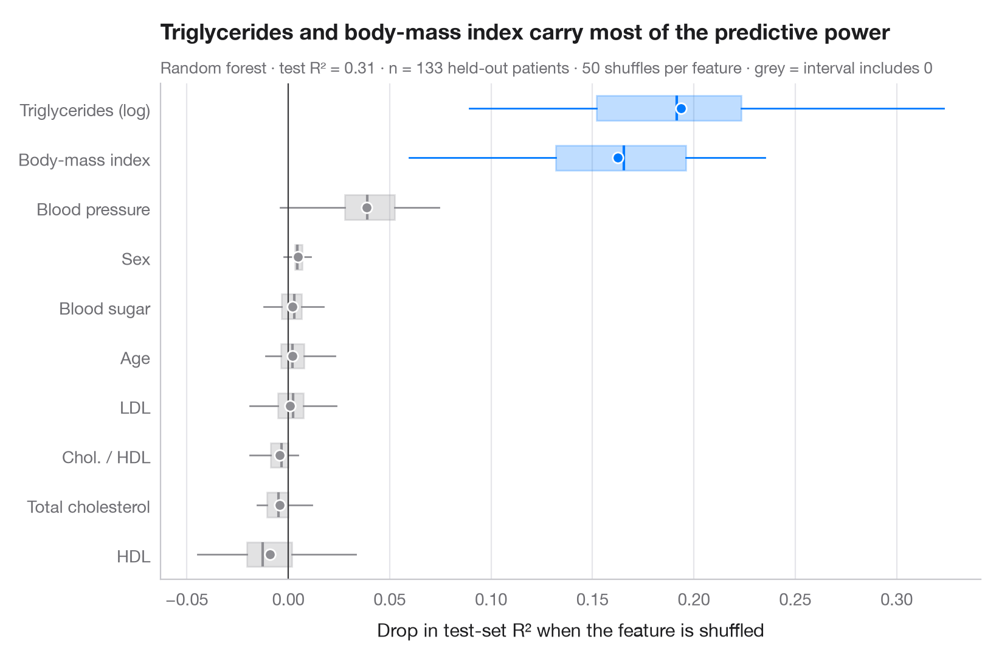

# Permutation importance

> Drop in test-set R² when each feature is shuffled, over 50 repeats per feature.



Permutation importance asks a simple, model-agnostic question: how much worse
does the model predict on **held-out** data when one feature is shuffled,
breaking its link with the outcome? A large drop means the model relies on
that feature. Shuffling is random, so it is repeated 50 times per feature; the
box shows the spread and the dot the mean. Features whose box straddles zero
carry no usable signal for this model.

Unlike the impurity-based importances built into tree models, permutation
importance is computed on test data, is comparable across model types and is
not biased towards features with many distinct values. It measures what the
**model** uses, not causal effects, and correlated features share (and can
hide) each other's importance. Data are the 442 diabetes patients bundled with
**scikit-learn**; the model is a random forest; importances come from
`sklearn.inspection.permutation_importance`.

**R equivalent:** `vip::vip(method = "permute")`  
**Libraries:** Matplotlib, NumPy, scikit-learn

```python
import matplotlib.pyplot as plt
import numpy as np
from sklearn.datasets import load_diabetes
from sklearn.ensemble import RandomForestRegressor
from sklearn.inspection import permutation_importance
from sklearn.model_selection import train_test_split

data = load_diabetes(as_frame=True, scaled=False)
X, y = data.data, data.target
names = {"age": "Age", "sex": "Sex", "bmi": "Body-mass index", "bp": "Blood pressure",
         "s1": "Total cholesterol", "s2": "LDL", "s3": "HDL", "s4": "Chol. / HDL",
         "s5": "Triglycerides (log)", "s6": "Blood sugar"}
X_tr, X_te, y_tr, y_te = train_test_split(X, y, test_size=0.3, random_state=0)

model = RandomForestRegressor(n_estimators=500, min_samples_leaf=3, random_state=0).fit(X_tr, y_tr)
r2 = model.score(X_te, y_te)
imp = permutation_importance(model, X_te, y_te, n_repeats=50, random_state=0, scoring="r2")

order = np.argsort(imp.importances_mean)
fig, ax = plt.subplots(figsize=(8, 5.2))
for i, j in enumerate(order):
    v = imp.importances[j]
    c = "#007AFF" if np.percentile(v, 2.5) > 0 else "#8E8E93"
    ax.boxplot(v, positions=[i], widths=0.5, vert=False, showfliers=False, patch_artist=True,
               boxprops=dict(facecolor=c, alpha=0.25, edgecolor=c), medianprops=dict(color=c, lw=1.5),
               whiskerprops=dict(color=c), capprops=dict(visible=False))
    ax.scatter(v.mean(), i, s=40, color=c, zorder=3, edgecolor="white", lw=1)
ax.axvline(0, color="#3A3A3C", lw=0.8)
ax.set_yticks(range(len(order)), [names[X.columns[j]] for j in order])
ax.set_xlabel("Drop in test-set R² when the feature is shuffled")
ax.grid(axis="x"); ax.grid(axis="y", visible=False)
ax.set_title("Triglycerides and body-mass index carry most of the predictive power", pad=26)
ax.text(0, 1.02, f"Random forest · test R² = {r2:.2f} · n = {len(X_te)} held-out patients · "
        "50 shuffles per feature · grey = interval includes 0", transform=ax.transAxes,
        fontsize=9.5, color="#6E6E73")
plt.show()
```

---

**PyStatlas** by [Thierry Warin](https://www.warin.ca) · [View on the website →](https://warint.github.io/pystatlas/machine-learning/permutation-importance/) · [← Machine learning](../README.md)

**Cite:** Warin, T. (2026). Permutation importance. In PyStatlas: The Python Gallery of Statistical Graphics. https://warint.github.io/pystatlas/machine-learning/permutation-importance/
