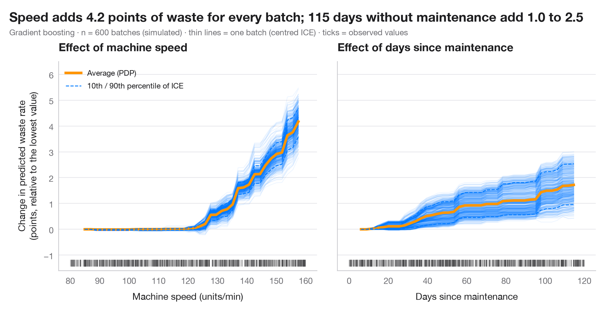

# Partial dependence with ICE curves

> How a batch's predicted waste rate changes with machine speed and with days since maintenance — the average (PDP) over one curve per batch (ICE).



A partial dependence plot (PDP) shows how the model's prediction changes, on
average, as one feature varies while all others keep their observed values.
Behind the average sit the **individual conditional expectation** (ICE)
curves — one per observation. Parallel ICE curves mean the effect is the same
for everyone; curves that fan out or cross reveal **interactions** that the
average hides. ICE curves are centred at the left edge so that their shapes,
not their levels, can be compared; the rug marks where the data actually are,
since the model extrapolates elsewhere.

The example is set in the context of Warin, d'Anglade and de Marcellis-Warin
(2025, *International Journal of Sustainable Engineering*) on data science for
waste reduction in manufacturing. The data are **simulated** for illustration
and are *not* the paper's data or results: the same n = 600 production
batches as in the model comparison. The left panel shows a threshold effect —
waste is flat at low machine speeds and climbs steeply at high speeds, with
nearly parallel curves for all batches. The right panel shows days since maintenance, whose ICE
curves fan out because its effect was built to depend on humidity. The model
is a gradient-boosting regressor, and the curves come from
`sklearn.inspection.partial_dependence(kind="both")`. A PDP describes the
model, not the world: it is causal only if the model is.

**R equivalent:** `pdp::partial(ice = TRUE) + autoplot() / iml::FeatureEffect`  
**Libraries:** Matplotlib, NumPy, pandas, scikit-learn

**Data:** Simulated data with a fixed random seed, created for this example. — No real respondents, documents or measurements: the numbers only illustrate how the chart and its statistics work.

**Data:** Warin, T., d'Anglade, P. M., & de Marcellis-Warin, N. (2025). Optimising industrial efficiency: Integrating K-means clustering and data science for sustainable manufacturing and waste reduction. International Journal of Sustainable Engineering, 18(1), 2527300. https://doi.org/10.1080/19397038.2025.2527300 — The example is set in the context of this paper; unless its description says otherwise, the numbers are simulated and are not the paper's data or results.


```python
import matplotlib.pyplot as plt
import numpy as np
import pandas as pd
from sklearn.ensemble import GradientBoostingRegressor
from sklearn.inspection import partial_dependence
# Simulated data, set in the context of Warin, d'Anglade & de Marcellis-Warin (2025) [warin2025waste]

# Data: 600 production batches; outcome = waste rate (% of material scrapped)
rng = np.random.default_rng(2025)
n = 600
names = {"speed": "Machine speed (units/min)", "temperature": "Temperature (°C)",
         "humidity": "Humidity (%)", "experience": "Operator experience (years)",
         "maintenance": "Days since maintenance", "grade": "Material grade (1 = best)",
         "batch_size": "Batch size (kg)"}
X = pd.DataFrame({"speed": rng.uniform(80, 160, n), "temperature": rng.uniform(195, 225, n),
                  "humidity": rng.uniform(30, 75, n), "experience": rng.gamma(2, 4, n),
                  "maintenance": rng.uniform(0, 120, n), "grade": rng.integers(1, 4, n),
                  "batch_size": rng.uniform(200, 1000, n)})       # batch size has no effect
y = (2 + 0.002 * np.clip(X.speed - 110, 0, None) ** 2            # waste climbs above 110 units/min
     + 0.025 * (X.temperature - 210) ** 2                        # U-shape around the 210 °C set point
     + 3 * np.exp(-X.experience / 3)                             # novices waste more, gains fade
     + 4 * (X.humidity - 30) / 45 * X.maintenance / 120          # humidity hurts worn machines most
     + 0.6 * (X.grade - 1) + rng.normal(0, 0.7, n))
model = GradientBoostingRegressor(learning_rate=0.05, n_estimators=300, max_depth=2,
                                  subsample=0.8, random_state=0).fit(X, y)

features = ["speed", "maintenance"]
change, spread = {}, {}
plt.rcParams["figure.constrained_layout.use"] = False   # manual margins leave room for the subtitle
fig, axes = plt.subplots(1, 2, figsize=(10, 5), sharey=True)
fig.subplots_adjust(left=0.10, right=0.97, top=0.80, bottom=0.12, wspace=0.08)
for ax, f in zip(axes, features):
    pd_res = partial_dependence(model, X, [f], kind="both", grid_resolution=40)
    grid = pd_res["grid_values"][0]
    ice = pd_res["individual"][0]
    ice_c = ice - ice[:, [0]]                      # centred ICE
    pdp_c = pd_res["average"][0] - pd_res["average"][0][0]
    change[f] = pdp_c[-1]                          # average effect over the whole range
    lo, hi = np.percentile(ice_c, [10, 90], axis=0)
    spread[f] = (lo[-1], hi[-1])
    ax.plot(grid, ice_c.T, color="#007AFF", alpha=0.07, lw=0.8)
    ax.plot(grid, pdp_c, color="#FF9500", lw=3, label="Average (PDP)")
    ax.plot(grid, lo, color="#007AFF", lw=1, ls="--")
    ax.plot(grid, hi, color="#007AFF", lw=1, ls="--", label="10th / 90th percentile of ICE")
    ax.plot(X[f], np.full(len(X), -1.3), "|", color="#3A3A3C", ms=8, alpha=0.4)   # rug
    ax.set_xlabel(names[f])
    ax.set_title(f"Effect of {names[f].split(' (')[0].lower()}")
axes[0].set_ylim(-1.6, 6.5)
axes[0].set_ylabel("Change in predicted waste rate\n(points, relative to the lowest value)")
axes[0].legend(loc="upper left", fontsize=9)
m_lo, m_hi = spread["maintenance"]
fig.suptitle(f"Speed adds {change['speed']:.1f} points of waste for every batch; {grid[-1]:.0f} days without "
             f"maintenance add {m_lo:.1f} to {m_hi:.1f}", x=0.02, y=0.97, ha="left")
fig.text(0.02, 0.885, f"Gradient boosting · n = {n} batches (simulated) · thin lines = one batch (centred ICE) · "
         "ticks = observed values", fontsize=9.5, color="#6E6E73")
plt.show()
```

---

**PyStatlas** by [Thierry Warin](https://www.warin.ca) · [View on the website →](https://warint.github.io/pystatlas/machine-learning/partial-dependence/) · [← Machine learning](../README.md)

**Cite:** Warin, T. (2026). Partial dependence with ICE curves. In PyStatlas: A Python Gallery of Statistical Graphics for the Social Sciences. https://warint.github.io/pystatlas/machine-learning/partial-dependence/
