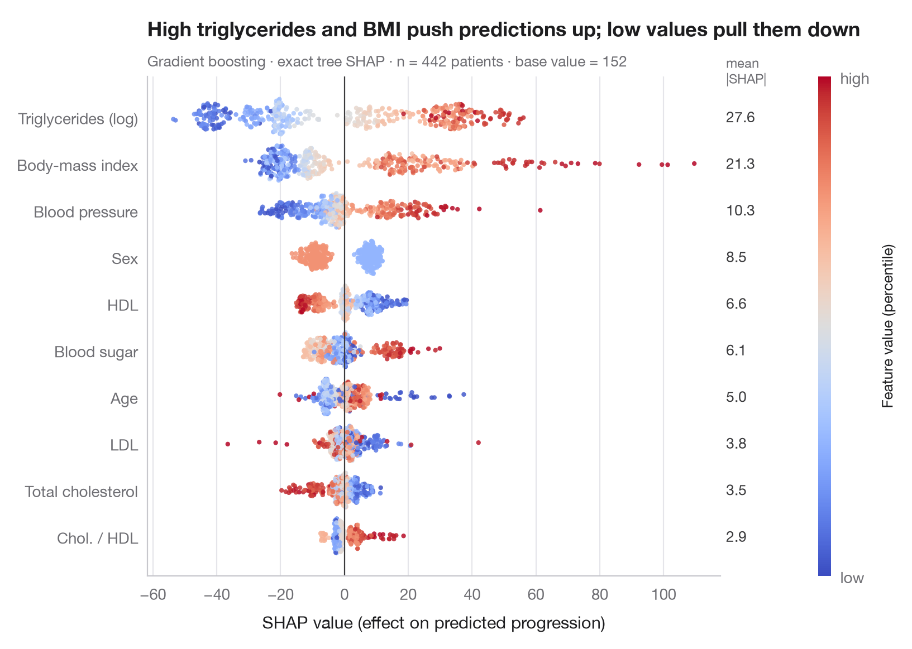

# SHAP summary (beeswarm)

> Every patient's SHAP value for every feature, coloured by the feature's value, with mean |SHAP| importance.



SHAP (SHapley Additive exPlanations; Lundberg and Lee, 2017) splits each
prediction into additive contributions, one per feature, so that
**base value + sum of contributions = prediction**. The contributions are
Shapley values from cooperative game theory: each feature's average marginal
effect over all orders in which features could be added.

The beeswarm shows one dot per patient and feature. Position is the SHAP
value — how far that feature pushed this patient's prediction up or down —
and colour is the feature's own value, from low (blue) to high (red). Features
are sorted by mean |SHAP|, printed on the right as a global importance. A
clean red-right / blue-left split means a monotone effect; mixed colours
signal non-linearity or interactions.

Data are the 442 diabetes patients bundled with **scikit-learn**; the model is
a gradient-boosting regressor and the exact tree SHAP values come from
`shap.TreeExplainer`. The figure is drawn with Matplotlib so it matches the
gallery style; `shap.plots.beeswarm` gives a similar view in one line.

**R equivalent:** `shapviz::sv_importance(kind = "beeswarm")`  
**Libraries:** Matplotlib, NumPy, SHAP, scikit-learn

```python
import matplotlib.pyplot as plt
import numpy as np
import shap
from sklearn.datasets import load_diabetes
from sklearn.ensemble import GradientBoostingRegressor

data = load_diabetes(as_frame=True, scaled=False)
X, y = data.data, data.target
names = {"age": "Age", "sex": "Sex", "bmi": "Body-mass index", "bp": "Blood pressure",
         "s1": "Total cholesterol", "s2": "LDL", "s3": "HDL", "s4": "Chol. / HDL",
         "s5": "Triglycerides (log)", "s6": "Blood sugar"}
model = GradientBoostingRegressor(learning_rate=0.05, n_estimators=300, max_depth=2,
                                  subsample=0.8, random_state=0).fit(X, y)

# Exact SHAP values for tree ensembles
sv = shap.TreeExplainer(model).shap_values(X)          # shape: (patients, features)
importance = np.abs(sv).mean(axis=0)
order = np.argsort(importance)                          # least important at the bottom

fig, ax = plt.subplots(figsize=(8, 5.6))
rng = np.random.default_rng(0)
cmap = plt.get_cmap("coolwarm")
for i, j in enumerate(order):
    v = sv[:, j]
    xv = X.iloc[:, j].rank(pct=True).to_numpy()         # colour = percentile of the feature value
    # Beeswarm-style vertical jitter: wider where the points are denser
    hist, edges = np.histogram(v, bins=60)
    dens = hist[np.clip(np.digitize(v, edges) - 1, 0, len(hist) - 1)] / hist.max()
    jitter = rng.uniform(-1, 1, len(v)) * 0.38 * np.sqrt(dens)
    ax.scatter(v, i + jitter, c=xv, cmap=cmap, s=9, alpha=0.85, lw=0, vmin=0, vmax=1)
    ax.text(1.01, i, f"{importance[j]:.1f}", transform=ax.get_yaxis_transform(), va="center",
            fontsize=9.5, color="#3A3A3C")
ax.axvline(0, color="#3A3A3C", lw=0.8)
ax.set_yticks(range(len(order)), [names[X.columns[j]] for j in order])
ax.set_xlabel("SHAP value (effect on predicted progression)")
ax.grid(axis="x"); ax.grid(axis="y", visible=False)
ax.text(1.01, len(order) - 0.35, "mean\n|SHAP|", transform=ax.get_yaxis_transform(),
        fontsize=8.5, color="#6E6E73", va="bottom")

cb = fig.colorbar(plt.cm.ScalarMappable(cmap=cmap), ax=ax, pad=0.09, aspect=40, ticks=[0, 1])
cb.ax.set_yticklabels(["low", "high"])
cb.set_label("Feature value (percentile)", fontsize=9.5)
cb.outline.set_visible(False)

ax.set_title("High triglycerides and BMI push predictions up; low values pull them down", pad=26)
ax.text(0, 1.02, f"Gradient boosting · exact tree SHAP · n = {len(X)} patients · "
        f"base value = {model.predict(X).mean():.0f}", transform=ax.transAxes, fontsize=9.5,
        color="#6E6E73")
plt.show()
```

---

**PyStatlas** by [Thierry Warin](https://www.warin.ca) · [View on the website →](https://warint.github.io/pystatlas/machine-learning/shap-beeswarm/) · [← Machine learning](../README.md)

**Cite:** Warin, T. (2026). SHAP summary (beeswarm). In PyStatlas: The Python Gallery of Statistical Graphics. https://warint.github.io/pystatlas/machine-learning/shap-beeswarm/
