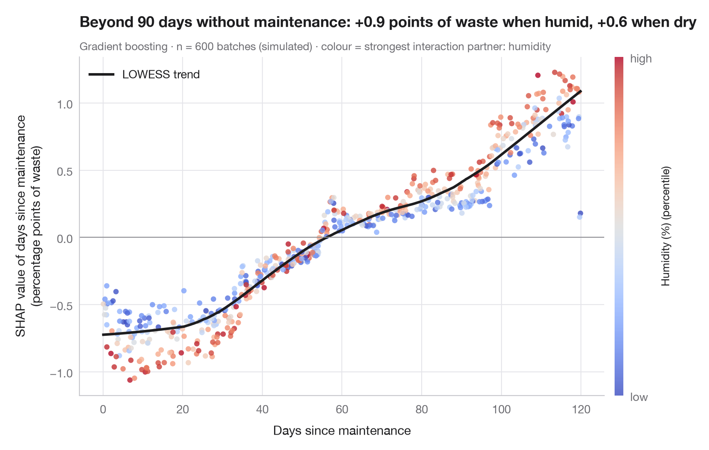

# SHAP dependence plot

> How the share of low-income students feeds into each district's predicted maths results, coloured by its strongest interaction partner, with a smooth trend.



A SHAP dependence plot zooms in on one feature. Each dot is a school district:
the horizontal axis is the feature's value, the vertical axis its SHAP value —
its contribution to that district's prediction. The trend line (a LOWESS
smooth) is close to a partial-dependence curve, but the cloud around it is
informative: at the same share of low-income students, contributions differ
from district to district because of **interactions** with other features.

Colour shows the feature that best explains that vertical spread, chosen here
as the feature whose SHAP **interaction** values with the share of low-income
students are largest on average (`shap.TreeExplainer.shap_interaction_values`).
Here it is the share of Hispanic students, which is also strongly correlated
with poverty (r ≈ 0.7), so the colour gradient partly reflects that
correlation rather than an interaction. Data are the
303 California school districts of the 1998 STAR test bundled with
**statsmodels** (`sm.datasets.star98`); the outcome is the share of students
scoring above the national median in maths, predicted from ten district
characteristics. The model is a gradient-boosting regressor; the smooth comes
from `statsmodels.nonparametric.lowess`.

**R equivalent:** `shapviz::sv_dependence()`  
**Libraries:** Matplotlib, NumPy, SHAP, statsmodels, scikit-learn

**Data:** Gill, J. (2001). Generalized Linear Models: A Unified Approach (Quantitative Applications in the Social Sciences, No. 134). Sage. https://www.statsmodels.org/stable/datasets/generated/star98.html — Original data from the California Department of Education's Standardized Testing and Reporting (STAR) program, 1998. Subset distributed with statsmodels (sm.datasets.star98) with the author's permission.


```python
import matplotlib.pyplot as plt
import numpy as np
import shap
import statsmodels.api as sm
from sklearn.ensemble import GradientBoostingRegressor
from statsmodels.nonparametric.smoothers_lowess import lowess

# Data: 303 California school districts; outcome = % of students above the national median in maths
d = sm.datasets.star98.load_pandas().data
y = 100 * d["NABOVE"] / (d["NABOVE"] + d["NBELOW"])
names = {"LOWINC": "% low-income students", "PERASIAN": "% Asian students", "PERBLACK": "% Black students",
         "PERHISP": "% Hispanic students", "AVYRSEXP": "Teacher experience (years)",
         "AVSALK": "Teacher salary ($000)", "PERSPENK": "Spending per pupil ($000)",
         "PTRATIO": "Pupils per teacher", "PCTAF": "% in college-prep courses",
         "PCTYRRND": "% year-round schools"}
X = d[list(names)]
model = GradientBoostingRegressor(learning_rate=0.05, n_estimators=300, max_depth=2,
                                  subsample=0.8, random_state=0).fit(X, y)

explainer = shap.TreeExplainer(model)
sv = explainer.shap_values(X)
inter = explainer.shap_interaction_values(X)            # (districts, features, features)

f = list(X.columns).index("LOWINC")
strength = np.abs(inter[:, f, :]).mean(axis=0)
strength[f] = 0
partner = int(np.argmax(strength))                       # strongest interaction partner

x, s = X.iloc[:, f].to_numpy(), sv[:, f]
col = X.iloc[:, partner].rank(pct=True).to_numpy()
trend = lowess(s, x, frac=0.35)

fig, ax = plt.subplots(figsize=(8, 5.2))
sc = ax.scatter(x, s, c=col, cmap="coolwarm", s=22, alpha=0.8, lw=0, vmin=0, vmax=1)
ax.plot(trend[:, 0], trend[:, 1], color="#1d1d1f", lw=2.2, label="LOWESS trend")
ax.axhline(0, color="#8E8E93", lw=0.8)
ax.set_xlabel("Low-income students (% of pupils)")
ax.set_ylabel("SHAP value of % low-income\n(percentage points)")
ax.grid(axis="x")
ax.legend(loc="upper right")
cb = fig.colorbar(sc, ax=ax, pad=0.02, aspect=40, ticks=[0, 1])
cb.ax.set_yticklabels(["low", "high"])
cb.set_label(f"{names[X.columns[partner]]} (percentile)", fontsize=9.5)
cb.outline.set_visible(False)

above = s[x > 50].mean()
ax.set_title(f"Where over half the pupils are low-income, poverty pulls predictions down {-above:.0f} points", pad=26)
ax.text(0, 1.02, f"Gradient boosting · n = {len(X)} districts · colour = strongest interaction "
        f"partner ({names[X.columns[partner]]})", transform=ax.transAxes, fontsize=9.5, color="#6E6E73")
plt.show()
```

---

**PyStatlas** by [Thierry Warin](https://www.warin.ca) · [View on the website →](https://warint.github.io/pystatlas/machine-learning/shap-dependence/) · [← Machine learning](../README.md)

**Cite:** Warin, T. (2026). SHAP dependence plot. In PyStatlas: The Python Gallery of Statistical Graphics for the Social Sciences. https://warint.github.io/pystatlas/machine-learning/shap-dependence/
