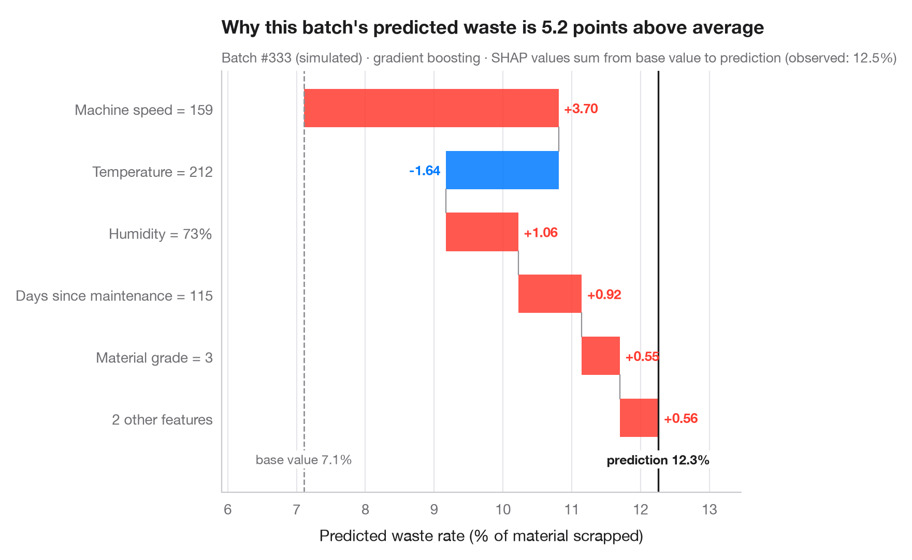

# SHAP waterfall for one prediction

> How each process feature moves one high-waste batch's predicted waste rate from the average to the model's output.



Global charts describe the model; a waterfall explains **one** prediction.
It starts from the base value — the model's average prediction over the
data — and adds each feature's SHAP value in turn, largest first, until it
reaches this batch's prediction. Red bars push the prediction up, blue bars
pull it down; the smallest contributions are pooled into one bar so the chart
stays readable. Because SHAP values are additive, the bars always sum exactly
to the gap between the base value and the prediction.

This is the chart to show when a single case must be explained — a batch
flagged by quality control, a loan, a benefit claim. It explains what the
**model** did, not why the outcome happens. The example is set in the context
of Warin, d'Anglade and de Marcellis-Warin (2025, *International Journal of
Sustainable Engineering*) on data science for waste reduction in
manufacturing. The data are **simulated** for illustration and are *not* the
paper's data or results: the same n = 600 production batches as in the model
comparison. The model is a gradient-boosting regressor; SHAP values come from
`shap.TreeExplainer`. The batch shown is a high-waste one (predicted more than
4 points above the base value) chosen because its explanation pulls in both
directions.

**R equivalent:** `shapviz::sv_waterfall()`  
**Libraries:** Matplotlib, NumPy, pandas, SHAP, scikit-learn

**Data:** Simulated data with a fixed random seed, created for this example. — No real respondents, documents or measurements: the numbers only illustrate how the chart and its statistics work.

**Data:** Warin, T., d'Anglade, P. M., & de Marcellis-Warin, N. (2025). Optimising industrial efficiency: Integrating K-means clustering and data science for sustainable manufacturing and waste reduction. International Journal of Sustainable Engineering, 18(1), 2527300. https://doi.org/10.1080/19397038.2025.2527300 — The example is set in the context of this paper; unless its description says otherwise, the numbers are simulated and are not the paper's data or results.


```python
import matplotlib.pyplot as plt
import numpy as np
import pandas as pd
import shap
from sklearn.ensemble import GradientBoostingRegressor
# Simulated data, set in the context of Warin, d'Anglade & de Marcellis-Warin (2025) [warin2025waste]

# Data: 600 production batches; outcome = waste rate (% of material scrapped)
rng = np.random.default_rng(2025)
n = 600
names = {"speed": "Machine speed (units/min)", "temperature": "Temperature (°C)",
         "humidity": "Humidity (%)", "experience": "Operator experience (years)",
         "maintenance": "Days since maintenance", "grade": "Material grade (1 = best)",
         "batch_size": "Batch size (kg)"}
X = pd.DataFrame({"speed": rng.uniform(80, 160, n), "temperature": rng.uniform(195, 225, n),
                  "humidity": rng.uniform(30, 75, n), "experience": rng.gamma(2, 4, n),
                  "maintenance": rng.uniform(0, 120, n), "grade": rng.integers(1, 4, n),
                  "batch_size": rng.uniform(200, 1000, n)})       # batch size has no effect
y = (2 + 0.002 * np.clip(X.speed - 110, 0, None) ** 2            # waste climbs above 110 units/min
     + 0.025 * (X.temperature - 210) ** 2                        # U-shape around the 210 °C set point
     + 3 * np.exp(-X.experience / 3)                             # novices waste more, gains fade
     + 4 * (X.humidity - 30) / 45 * X.maintenance / 120          # humidity hurts worn machines most
     + 0.6 * (X.grade - 1) + rng.normal(0, 0.7, n))
fmt = {"speed": "{:.0f}", "temperature": "{:.0f}", "humidity": "{:.0f}%", "experience": "{:.1f}",
       "maintenance": "{:.0f}", "grade": "{:.0f}", "batch_size": "{:.0f}"}
model = GradientBoostingRegressor(learning_rate=0.05, n_estimators=300, max_depth=2,
                                  subsample=0.8, random_state=0).fit(X, y)

explainer = shap.TreeExplainer(model)
base = float(np.ravel(explainer.expected_value)[0])
all_sv = explainer.shap_values(X)
# A high-waste batch whose explanation has pushes in both directions
high = np.where(all_sv.sum(axis=1) > 4)[0]
p = int(high[np.argmin(all_sv[high].min(axis=1))])
sv = all_sv[p]

# Largest contributions first; pool the rest
k = 5
idx = np.argsort(np.abs(sv))[::-1]
top, rest = idx[:k], idx[k:]
labels = [f"{names[X.columns[j]].split(' (')[0]} = {fmt[X.columns[j]].format(X.iloc[p, j])}" for j in top]
values = list(sv[top])
if len(rest):
    labels.append(f"{len(rest)} other features")
    values.append(sv[rest].sum())

fig, ax = plt.subplots(figsize=(8, 5.2))
start = base
for i, (lab, v) in enumerate(zip(labels, values)):
    c = "#FF3B30" if v > 0 else "#007AFF"
    ax.barh(i, v, left=start, color=c, alpha=0.85, height=0.62)
    ax.text(start + v + (0.08 if v > 0 else -0.08), i, f"{v:+.2f}", va="center",
            ha="left" if v > 0 else "right", fontsize=9.5, color=c, fontweight="semibold")
    if i < len(values) - 1:
        ax.plot([start + v] * 2, [i + 0.31, i + 0.69], color="#8E8E93", lw=0.8)
    start += v
ax.axvline(base, color="#8E8E93", ls="--", lw=1)
ax.axvline(start, color="#1d1d1f", lw=1.2)
bottom = len(labels) - 0.45
ax.text(base, bottom, f"base value {base:.1f}%", ha="center", va="top", fontsize=9, color="#6E6E73",
        bbox=dict(fc="white", ec="none", pad=1))
ax.text(start, bottom, f"prediction {start:.1f}%", ha="center", va="top", fontsize=9,
        color="#1d1d1f", fontweight="semibold", bbox=dict(fc="white", ec="none", pad=1))
ax.set_yticks(range(len(labels)), labels)
ax.set_ylim(len(labels) + 0.2, -0.6)
path = base + np.cumsum(values)
ax.set_xlim(min(base, *path) - 1.2, max(base, *path) + 1.2)
ax.set_xlabel("Predicted waste rate (% of material scrapped)")
ax.grid(axis="x"); ax.grid(axis="y", visible=False)
ax.set_title(f"Why this batch's predicted waste is {start - base:.1f} points above average", pad=26)
ax.text(0, 1.02, f"Batch #{p} (simulated) · gradient boosting · SHAP values sum from base value to "
        f"prediction (observed: {y.iloc[p]:.1f}%)", transform=ax.transAxes, fontsize=9.5, color="#6E6E73")
plt.show()
```

---

**PyStatlas** by [Thierry Warin](https://www.warin.ca) · [View on the website →](https://warint.github.io/pystatlas/machine-learning/shap-waterfall/) · [← Machine learning](../README.md)

**Cite:** Warin, T. (2026). SHAP waterfall for one prediction. In PyStatlas: A Python Gallery of Statistical Graphics for the Social Sciences. https://warint.github.io/pystatlas/machine-learning/shap-waterfall/
