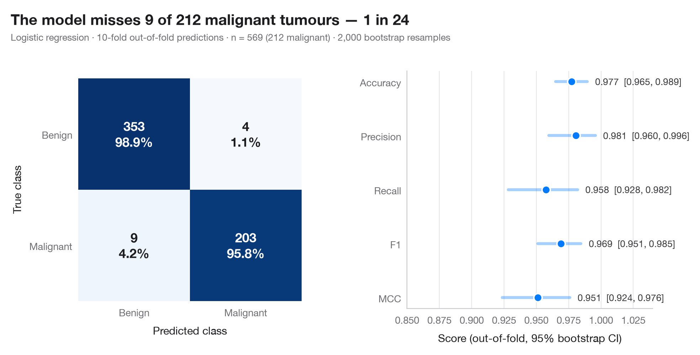
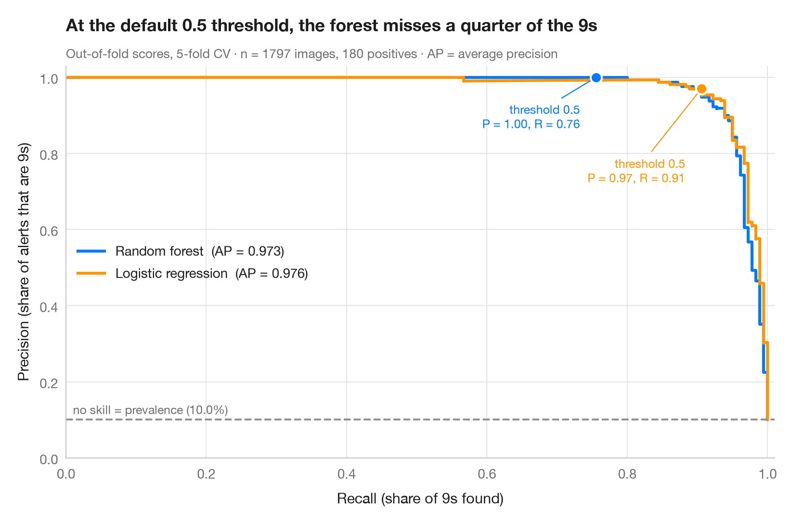
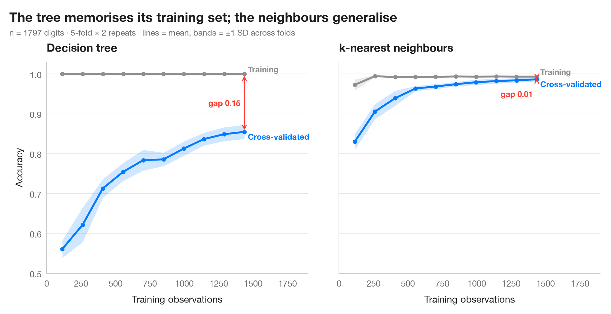
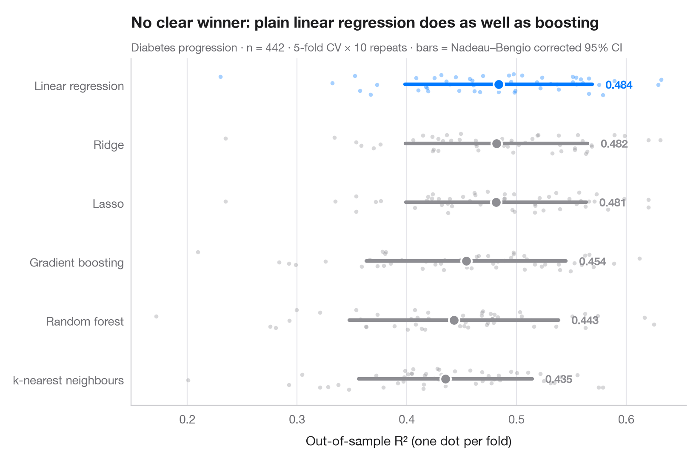
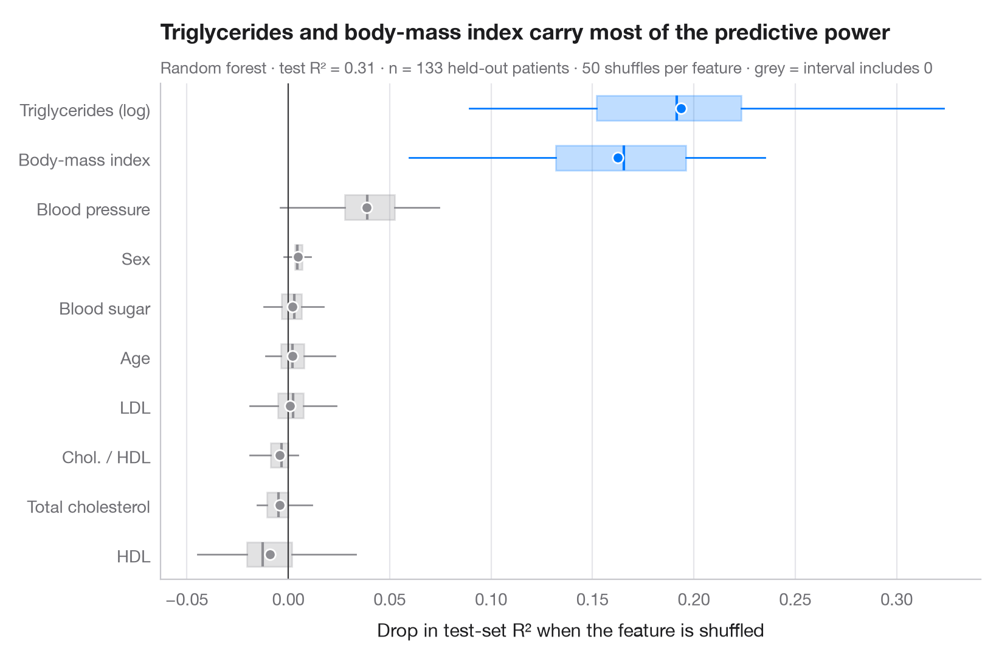
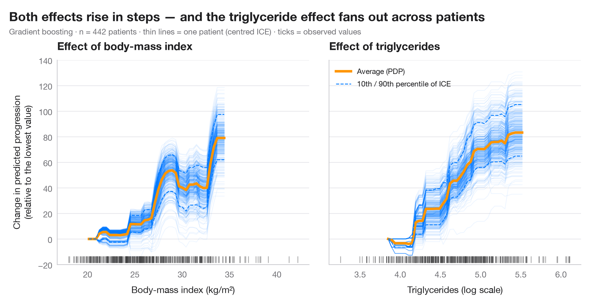
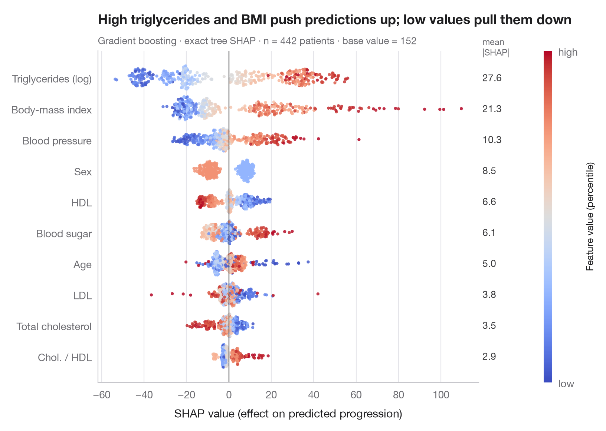
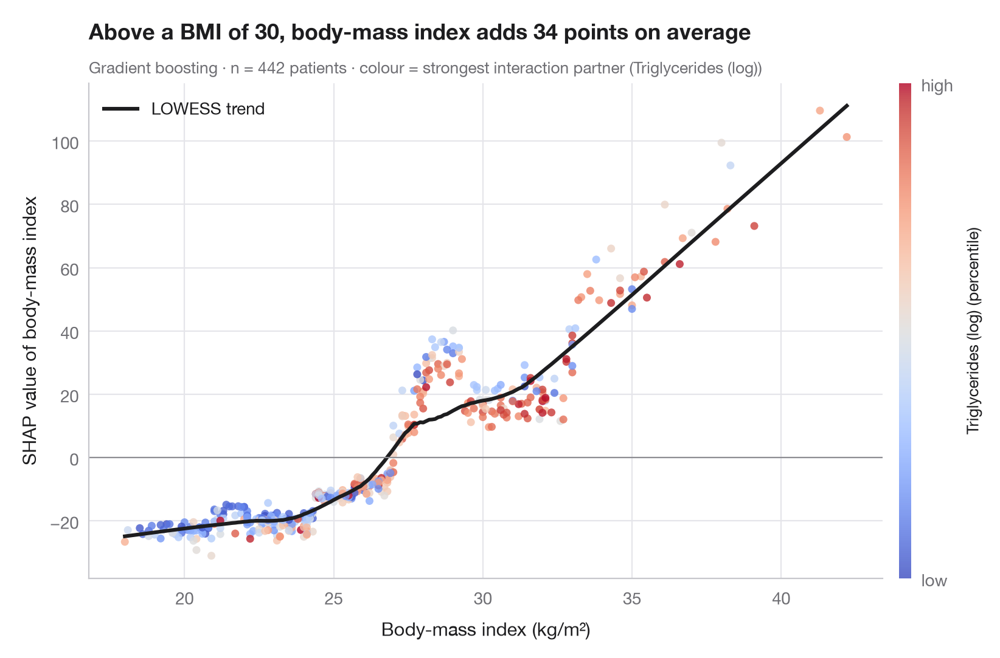
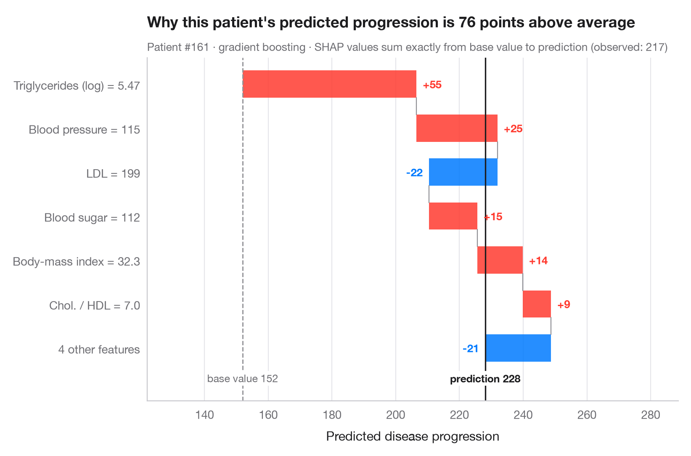

# Machine learning

How well does a model predict on new data, and why? Out-of-fold evaluation, learning curves and model-agnostic explanations — each with its uncertainty.

| Chart | Description |
|:--|:--|
|  | **[Confusion matrix with metrics](01-confusion-matrix/)** Out-of-fold confusion matrix with counts and row shares, and bootstrap intervals for the headline metrics. `yardstick::conf_mat() + autoplot()` |
|  | **[Precision–recall curves](02-precision-recall/)** Out-of-fold precision–recall curves for two classifiers, with average precision and the no-skill baseline. `yardstick::pr_curve() + autoplot()` |
|  | **[Learning curve](03-learning-curve/)** Training and cross-validated score as the training set grows, with fold-to-fold spread. `caret::learning_curve_dat() + ggplot()` |
|  | **[Cross-validated model comparison](04-model-comparison/)** Fold-by-fold scores of several models, with means and corrected 95% intervals. `caret::resamples() + bwplot() / tune::autoplot()` |
|  | **[Permutation importance](05-permutation-importance/)** Drop in test-set R² when each feature is shuffled, over 50 repeats per feature. `vip::vip(method = "permute")` |
|  | **[Partial dependence with ICE curves](06-partial-dependence/)** Average model response to one feature (PDP) over the individual curves (ICE) of every patient. `pdp::partial(ice = TRUE) + autoplot() / iml::FeatureEffect` |
|  | **[SHAP summary (beeswarm)](07-shap-beeswarm/)** Every patient's SHAP value for every feature, coloured by the feature's value, with mean |SHAP| importance. `shapviz::sv_importance(kind = "beeswarm")` |
|  | **[SHAP dependence plot](08-shap-dependence/)** SHAP value of one feature against its value, coloured by its strongest interaction partner, with a smooth trend. `shapviz::sv_dependence()` |
|  | **[SHAP waterfall for one prediction](09-shap-waterfall/)** How each feature moves one patient's prediction from the average to the model's output. `shapviz::sv_waterfall()` |

[← All families](../../README.md) · [Browse on the website](https://warint.github.io/pystatlas/machine-learning/)
