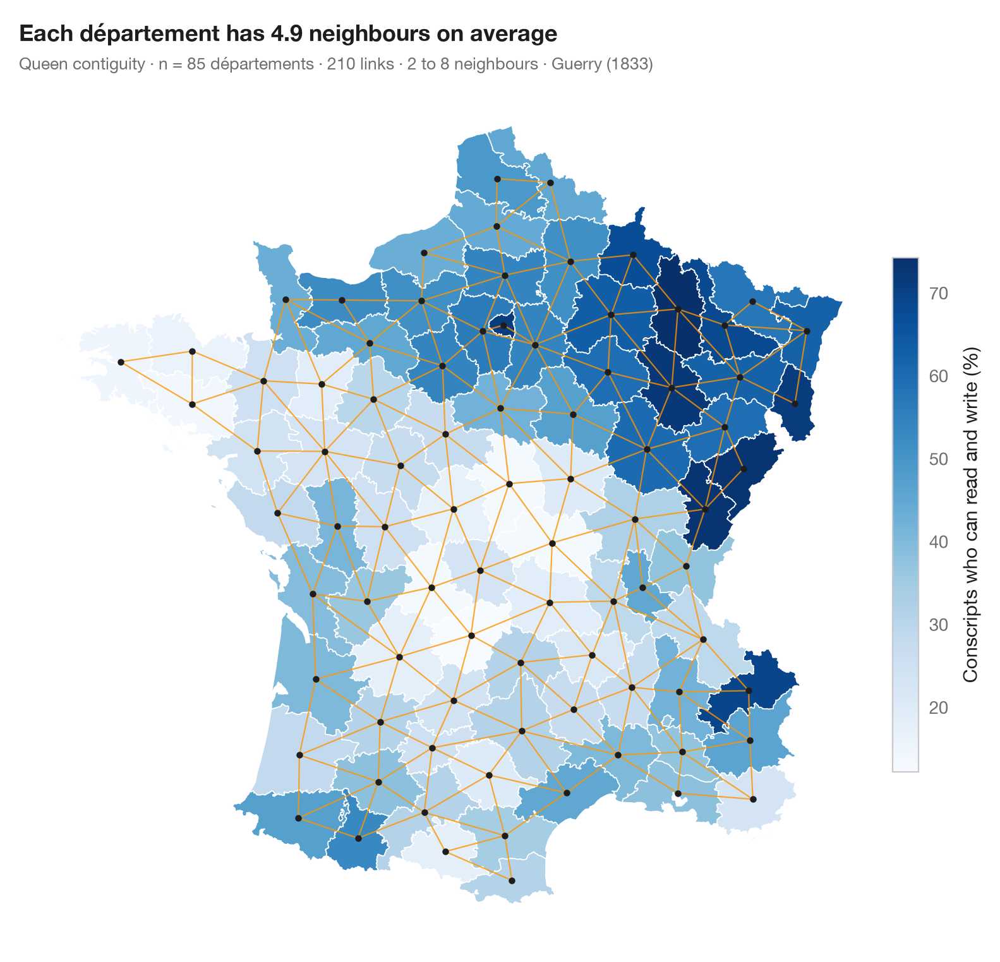

# Choropleth with spatial weights

> A map of one variable with the neighbour network drawn on top — the structure every spatial statistic relies on.



Every spatial statistic starts by deciding who is a neighbour of whom. This
chart shows that decision before any test is run: a choropleth of one
variable, with a line joining the centres of every pair of neighbouring
areas. Here neighbours share a border or a corner (**queen contiguity**), and
each row of the weights matrix is later standardised so that an area's
"spatial lag" is the average of its neighbours. Other choices — rook
contiguity, the k nearest neighbours, a distance band — give different
networks and can change the results, so the network is worth looking at.

Data are André-Michel Guerry's *Essay on the Moral Statistics of France*
(1833): 85 départements around 1830, as prepared by the Center for Spatial
Data Science and loaded with **libpysal** (`examples.load_example("Guerry")`,
fetched once and cached). The variable is the percentage of military
conscripts who could read and write. Weights come from
`libpysal.weights.Queen`; the map is drawn with **GeoPandas**.

**R equivalent:** `spdep::poly2nb() + plot(nb, coords)`  
**Libraries:** GeoPandas, Matplotlib, NumPy, libpysal

**Data:** Guerry, A.-M. (1833). Essai sur la statistique morale de la France. Crochard. Data as compiled in Friendly, M. (2007). A.-M. Guerry's moral statistics of France: Challenges for multivariable spatial analysis. Statistical Science, 22(3), 368–399. https://doi.org/10.1214/07-STS241 — Prepared by the Center for Spatial Data Science (University of Chicago) from the R package Guerry (Friendly and Dray), provided “as is”. Fetched once and cached by libpysal (examples.load_example("Guerry")). Variables come from Guerry's tables as translated by Whitt and Reinking (2002).


```python
import geopandas as gpd
import matplotlib.pyplot as plt
import numpy as np
from libpysal import examples, weights

# Data: 85 French départements, c. 1830 (Guerry, 1833)
g = gpd.read_file(examples.load_example("Guerry").get_path("guerry.shp"))
y = g["Litercy"]                      # % of conscripts who can read and write

# Queen contiguity: neighbours share a border or a corner
w = weights.Queen.from_dataframe(g, use_index=False)
cards = np.array(list(w.cardinalities.values()))
xy = np.column_stack([g.centroid.x, g.centroid.y])

fig, ax = plt.subplots(figsize=(8, 7.4))
g.plot(column=y, cmap="Blues", edgecolor="white", linewidth=0.6, ax=ax, legend=True,
       legend_kwds=dict(label="Conscripts who can read and write (%)", shrink=0.6, pad=0.01))
for i, nbrs in w.neighbors.items():
    for j in nbrs:
        if i < j:                      # draw each link once
            ax.plot(*xy[[i, j]].T, color="#FF9500", lw=0.8, alpha=0.8)
ax.scatter(*xy.T, s=10, color="#1D1D1F", zorder=3)
ax.set_axis_off()
ax.set_title(f"Each département has {w.mean_neighbors:.1f} neighbours on average", pad=26)
ax.text(0, 1.02, f"Queen contiguity · n = {w.n} départements · {int(w.s0 / 2)} links · "
        f"{cards.min()} to {cards.max()} neighbours · Guerry (1833)",
        transform=ax.transAxes, fontsize=9.5, color="#6E6E73")
plt.show()
```

---

**PyStatlas** by [Thierry Warin](https://www.warin.ca) · [View on the website →](https://warint.github.io/pystatlas/spatial-data/spatial-weights/) · [← Spatial data](../README.md)

**Cite:** Warin, T. (2026). Choropleth with spatial weights. In PyStatlas: A Python Gallery of Statistical Graphics for the Social Sciences. https://warint.github.io/pystatlas/spatial-data/spatial-weights/
