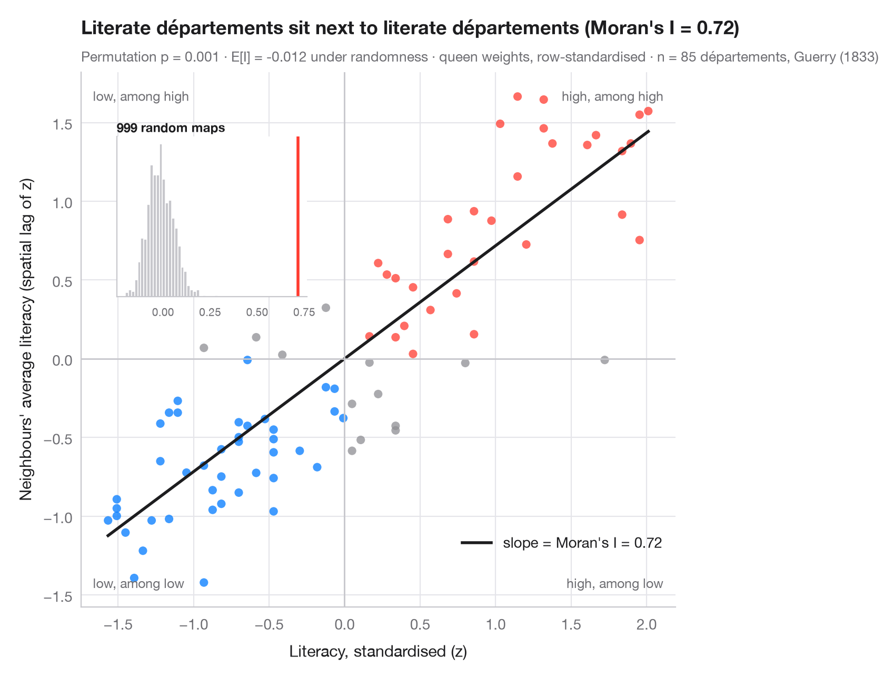

# Moran scatterplot (global autocorrelation)

> Each area against the average of its neighbours, with Moran's I, its permutation test and the reference distribution.



**Global** spatial autocorrelation asks one question for the whole map: do
similar values sit next to each other more than chance would allow? The
Moran scatterplot answers it visually. Each point is an area: on the
horizontal axis its own (standardised) value, on the vertical axis the
average of its neighbours — the **spatial lag**. With row-standardised
weights, the slope of the fitted line is exactly **Moran's I** (Moran, 1950).
Points in the upper-right and lower-left quadrants are areas that resemble
their neighbours; the other two quadrants hold spatial outliers.

Inference is by permutation: the values are shuffled across the map 999
times and I is recomputed each time. The inset shows that reference
distribution under spatial randomness; the pseudo p-value is the share of
shuffles at least as extreme as the observed I.

Data are **simulated**, set in the context of the GVCdtLab, CIRANO's digital twin
of the Great Lakes–St. Lawrence trade and transport corridor: 276 hexagonal
zones along a schematic waterway from Duluth and Chicago to the Gulf of
St. Lawrence, each with a 0–100 index of how exposed its shipping is to low
water levels. Neither the zones nor the values are the lab's data or results.
Weights are queen contiguity and the statistic comes from `esda.Moran`.

**R equivalent:** `spdep::moran.plot() + spdep::moran.mc()`  
**Libraries:** GeoPandas, Matplotlib, NumPy, esda, libpysal, Shapely

**Data:** Simulated data with a fixed random seed, created for this example. — No real respondents, documents or measurements: the numbers only illustrate how the chart and its statistics work.

**Data:** CIRANO. GVCdtLab: Digital twin of the Great Lakes–St. Lawrence trade and transport corridor (researcher in charge: T. Warin). Supported by Transport Canada's National Trade Corridors Fund; research on hydrological change, maritime traffic and trade funded by the Fonds de recherche du Québec. https://cirano.qc.ca/en/research/pole/Transport — The examples are set in the context of the lab's work; the hexagonal zones form a schematic map of the corridor and the values are simulated — they are not the lab's data, geography or results.


```python
import geopandas as gpd
import matplotlib.pyplot as plt
import numpy as np
from esda.moran import Moran
from libpysal import weights
from shapely.geometry import MultiLineString, Point, Polygon

# Simulated data, set in the context of the CIRANO GVCdtLab [gvcdtlab]
# Schematic corridor: hexagonal zones within reach of the waterway, Duluth and Chicago to the Gulf
main = [(-92.1, 46.8), (-89.2, 48.4), (-84.4, 46.5), (-82.4, 44.0), (-83.0, 42.3), (-81.2, 42.2),
        (-79.0, 42.9), (-79.4, 43.6), (-76.5, 44.2), (-73.6, 45.5), (-71.2, 46.8), (-68.5, 48.5),
        (-64.5, 49.2)]
michigan = [(-84.0, 45.6), (-86.6, 45.4), (-87.0, 43.5), (-87.6, 41.9)]
k = np.cos(np.radians(45))                      # shrink longitudes so the hexagons are regular
water = MultiLineString([[(x * k, y) for x, y in line] for line in (main, michigan)])
r, hexes = 0.3, []
for col in range(90):
    for row in range(36):
        cx, cy = -66.5 + 1.5 * r * col, 40.5 + np.sqrt(3) * r * (row + (col % 2) / 2)
        if water.distance(Point(cx, cy)) < 0.95:
            hexes.append(Polygon([(round(cx + r * np.cos(a), 6), round(cy + r * np.sin(a), 6))
                                  for a in np.radians(range(0, 360, 60))]))
g = gpd.GeoDataFrame(geometry=hexes)
xy = np.column_stack([g.centroid.x / k, g.centroid.y])      # back to longitude, latitude

# Exposure to low water: high at shallow passages (Seaway, connecting channels, upper lakes),
# low in the deep tidal estuary, plus spatially smooth noise and one draft-limited harbour
def bump(lon, lat, s):
    return np.exp(-((xy[:, 0] - lon) ** 2 + (xy[:, 1] - lat) ** 2) / (2 * s ** 2))
w = weights.Queen.from_dataframe(g, use_index=False)
w.transform = "r"
rng = np.random.default_rng(12)
noise = rng.normal(0, 1, len(g))
for _ in range(2):
    noise = weights.lag_spatial(w, noise)       # smooth the noise over neighbours
exposure = (35 + 30 * bump(-74.8, 45.0, 1.6) + 22 * bump(-82.7, 42.7, 1.2) + 20 * bump(-90.3, 47.6, 1.8)
            - 25 * bump(-67.0, 48.8, 2.2) + 12 * noise + rng.normal(0, 4, len(g)))
exposure[np.argmin(np.hypot(xy[:, 0] + 66.0, xy[:, 1] - 49.0))] = 75        # outlier harbour
g["exposure"] = exposure.clip(0, 100).round(1)
y = g["exposure"].to_numpy()

# Moran's I with row-standardised queen weights (w above) and 999 permutations
mi = Moran(y, w, permutations=999)
z = (y - y.mean()) / y.std()
lag = weights.lag_spatial(w, z)              # average of the neighbours' z-scores

fig, ax = plt.subplots(figsize=(8, 6.2))
quad = np.select([(z > 0) & (lag > 0), (z < 0) & (lag < 0)], ["#FF3B30", "#007AFF"], "#8E8E93")
ax.scatter(z, lag, s=34, c=quad, alpha=0.75, lw=0)
xs = np.array([z.min(), z.max()])
ax.plot(xs, mi.I * xs, color="#1D1D1F", lw=2, label=f"slope = Moran's I = {mi.I:.2f}")
ax.axhline(0, color="#C7C7CC", lw=1); ax.axvline(0, color="#C7C7CC", lw=1)
for (tx, ty, txt) in [(0.98, 0.97, "high, among high"), (0.02, 0.03, "low, among low"),
                      (0.02, 0.97, "low, among high"), (0.98, 0.03, "high, among low")]:
    ax.text(tx, ty, txt, transform=ax.transAxes, ha="right" if tx > 0.5 else "left",
            va="top" if ty > 0.5 else "bottom", fontsize=9, color="#6E6E73")
ax.set_xlabel("Exposure to low water, standardised (z)")
ax.set_ylabel("Neighbours' average exposure (spatial lag of z)")
ax.grid(axis="x")
ax.set_ylim(-2.7, 2.8)
ax.legend(loc="lower right", bbox_to_anchor=(1, 0.08))

# Inset: reference distribution of I under spatial randomness
ins = ax.inset_axes([0.06, 0.58, 0.32, 0.3])
ins.hist(mi.sim, bins=30, color="#C7C7CC", edgecolor="white")
ins.axvline(mi.I, color="#FF3B30", lw=2)
ins.set_title("999 random maps", fontsize=8.5, loc="left", pad=3)
ins.tick_params(labelsize=7.5); ins.set_yticks([]); ins.grid(False)

ax.set_title(f"Exposed zones sit next to exposed zones (Moran's I = {mi.I:.2f})", pad=26)
ax.text(0, 1.02, f"Permutation p = {mi.p_sim:.3f} · E[I] = {mi.EI:.3f} under randomness · "
        f"queen weights, row-standardised · n = {w.n} corridor zones (simulated)",
        transform=ax.transAxes, fontsize=9.5, color="#6E6E73")
plt.show()
```

---

**PyStatlas** by [Thierry Warin](https://www.warin.ca) · [View on the website →](https://warint.github.io/pystatlas/spatial-data/moran-scatterplot/) · [← Spatial data](../README.md)

**Cite:** Warin, T. (2026). Moran scatterplot (global autocorrelation). In PyStatlas: A Python Gallery of Statistical Graphics for the Social Sciences (Version 1.1.0) [Computer software]. https://warint.github.io/pystatlas/spatial-data/moran-scatterplot/
