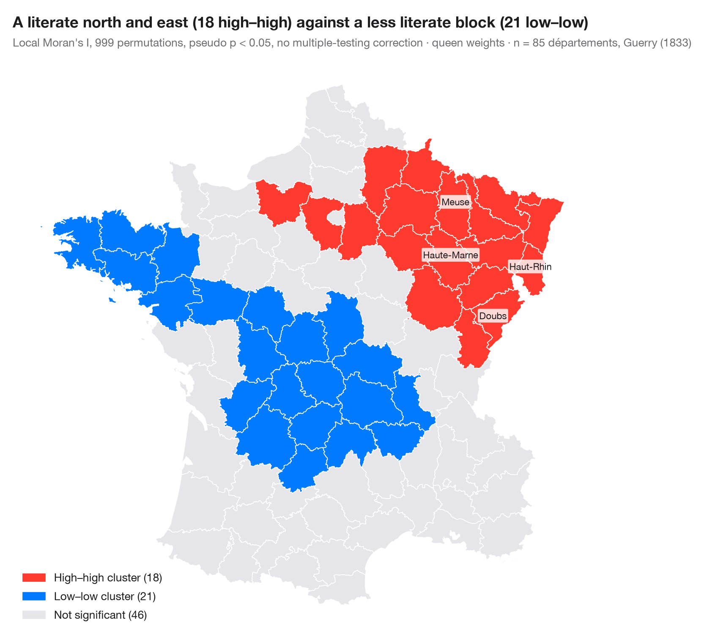

# LISA cluster map (local autocorrelation)

> Where the clusters and spatial outliers are — local Moran's I for each area, mapped with its permutation significance.



A global statistic says *whether* a map is clustered; a **local** indicator
of spatial association (LISA; Anselin, 1995) says *where*. Local Moran's I
is computed for each area from its own value and its neighbours' values.
Areas whose local statistic is significant (pseudo p < 0.05, 999 conditional
permutations) are coloured by quadrant of the Moran scatterplot:
**high–high** and **low–low** clusters, and **high–low** or **low–high**
spatial outliers. Everything else is grey.

Two cautions come with every LISA map. The tests are not independent and are
not corrected for multiple comparisons, so a few significant areas are
expected by chance alone; and a significant area marks the *core* of a
cluster, which usually extends to its neighbours.

Data are **simulated**, set in the context of the GVCdtLab, CIRANO's digital twin
of the Great Lakes–St. Lawrence trade and transport corridor: 276 hexagonal
zones along a schematic waterway from Duluth and Chicago to the Gulf of
St. Lawrence, each with a 0–100 index of how exposed its shipping is to low
water levels. Neither the zones nor the values are the lab's data or results.
The statistic comes from `esda.Moran_Local` and the map from **GeoPandas**.

**R equivalent:** `spdep::localmoran_perm() / rgeoda::local_moran()`  
**Libraries:** GeoPandas, Matplotlib, NumPy, esda, libpysal, Shapely

**Data:** Simulated data with a fixed random seed, created for this example. — No real respondents, documents or measurements: the numbers only illustrate how the chart and its statistics work.

**Data:** CIRANO. GVCdtLab: Digital twin of the Great Lakes–St. Lawrence trade and transport corridor (researcher in charge: T. Warin). Supported by Transport Canada's National Trade Corridors Fund; research on hydrological change, maritime traffic and trade funded by the Fonds de recherche du Québec. https://cirano.qc.ca/en/research/pole/Transport — The examples are set in the context of the lab's work; the hexagonal zones form a schematic map of the corridor and the values are simulated — they are not the lab's data, geography or results.


```python
import geopandas as gpd
import matplotlib.pyplot as plt
import numpy as np
from esda.moran import Moran_Local
from libpysal import weights
from matplotlib.patches import Patch
from shapely.geometry import MultiLineString, Point, Polygon

# Simulated data, set in the context of the CIRANO GVCdtLab [gvcdtlab]
# Schematic corridor: hexagonal zones within reach of the waterway, Duluth and Chicago to the Gulf
main = [(-92.1, 46.8), (-89.2, 48.4), (-84.4, 46.5), (-82.4, 44.0), (-83.0, 42.3), (-81.2, 42.2),
        (-79.0, 42.9), (-79.4, 43.6), (-76.5, 44.2), (-73.6, 45.5), (-71.2, 46.8), (-68.5, 48.5),
        (-64.5, 49.2)]
michigan = [(-84.0, 45.6), (-86.6, 45.4), (-87.0, 43.5), (-87.6, 41.9)]
k = np.cos(np.radians(45))                      # shrink longitudes so the hexagons are regular
water = MultiLineString([[(x * k, y) for x, y in line] for line in (main, michigan)])
r, hexes = 0.3, []
for col in range(90):
    for row in range(36):
        cx, cy = -66.5 + 1.5 * r * col, 40.5 + np.sqrt(3) * r * (row + (col % 2) / 2)
        if water.distance(Point(cx, cy)) < 0.95:
            hexes.append(Polygon([(round(cx + r * np.cos(a), 6), round(cy + r * np.sin(a), 6))
                                  for a in np.radians(range(0, 360, 60))]))
g = gpd.GeoDataFrame(geometry=hexes)
xy = np.column_stack([g.centroid.x / k, g.centroid.y])      # back to longitude, latitude

# Exposure to low water: high at shallow passages (Seaway, connecting channels, upper lakes),
# low in the deep tidal estuary, plus spatially smooth noise and one draft-limited harbour
def bump(lon, lat, s):
    return np.exp(-((xy[:, 0] - lon) ** 2 + (xy[:, 1] - lat) ** 2) / (2 * s ** 2))
w = weights.Queen.from_dataframe(g, use_index=False)
w.transform = "r"
rng = np.random.default_rng(12)
noise = rng.normal(0, 1, len(g))
for _ in range(2):
    noise = weights.lag_spatial(w, noise)       # smooth the noise over neighbours
exposure = (35 + 30 * bump(-74.8, 45.0, 1.6) + 22 * bump(-82.7, 42.7, 1.2) + 20 * bump(-90.3, 47.6, 1.8)
            - 25 * bump(-67.0, 48.8, 2.2) + 12 * noise + rng.normal(0, 4, len(g)))
exposure[np.argmin(np.hypot(xy[:, 0] + 66.0, xy[:, 1] - 49.0))] = 75        # outlier harbour
g["exposure"] = exposure.clip(0, 100).round(1)

lisa = Moran_Local(g["exposure"].to_numpy(), w, permutations=999, seed=1)

# Quadrants: 1 high–high, 2 low–high, 3 low–low, 4 high–low; grey if not significant
labels = {1: "High–high cluster", 3: "Low–low cluster", 2: "Low–high outlier", 4: "High–low outlier"}
colors = {1: "#FF3B30", 3: "#007AFF", 2: "#9FCBFF", 4: "#FFA8A2"}
sig = lisa.p_sim < 0.05
g["cluster"] = np.where(sig, lisa.q, 0)
counts = {q: int((g["cluster"] == q).sum()) for q in labels}

fig, ax = plt.subplots(figsize=(11, 5.2))
g.plot(color=[colors.get(c, "#E5E5EA") for c in g["cluster"]], edgecolor="white", linewidth=0.6, ax=ax)
handles = [Patch(color=colors[q], label=f"{labels[q]} ({counts[q]})") for q in labels if counts[q]]
handles.append(Patch(color="#E5E5EA", label=f"Not significant ({int((~sig).sum())})"))
ax.legend(handles=handles, loc="lower right", fontsize=9.5)
for name, lon, lat, dx, dy in [("Duluth", -92.1, 46.8, -0.6, -0.9), ("Detroit", -83.0, 42.3, 0, -1.2),
                              ("Montréal", -73.6, 45.5, 0.9, -1.1), ("Québec", -71.2, 46.8, 1.3, -0.9)]:
    ax.annotate(name, (lon * k, lat), (lon * k + dx, lat + dy), ha="center", va="center", fontsize=9.5,
                bbox=dict(boxstyle="round,pad=0.2", fc="white", ec="#C7C7CC", lw=0.6),
                arrowprops=dict(arrowstyle="-", color="#3A3A3C", lw=0.8))
ax.set_axis_off()
ax.set_title(f"Local Moran's I finds {counts[1]} high–high and {counts[3]} low–low zones on the simulated map", pad=26)
ax.text(0, 1.02, f"Local Moran's I, 999 permutations, pseudo p < 0.05, no multiple-testing correction · "
        f"queen weights · n = {w.n} zones (simulated)", transform=ax.transAxes, fontsize=9.5, color="#6E6E73")
plt.show()
```

---

**PyStatlas** by [Thierry Warin](https://www.warin.ca) · [View on the website →](https://warint.github.io/pystatlas/spatial-data/lisa-cluster-map/) · [← Spatial data](../README.md)

**Cite:** Warin, T. (2026). LISA cluster map (local autocorrelation). In PyStatlas: A Python Gallery of Statistical Graphics for the Social Sciences (Version 1.1.0) [Computer software]. https://warint.github.io/pystatlas/spatial-data/lisa-cluster-map/
