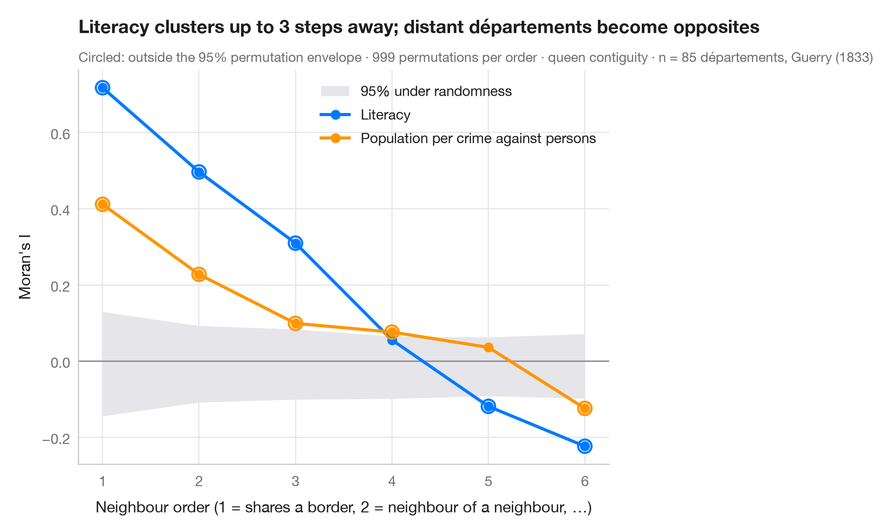

# Spatial correlogram

> Moran's I at increasing neighbour orders, with a permutation envelope — how far spatial clustering reaches.



Moran's I with first-order neighbours measures clustering at the shortest
range. A spatial correlogram repeats the computation for neighbours of order
2 (neighbours of neighbours, excluding closer ones), 3, and so on. The curve
shows the **spatial scale** of a pattern: how many steps away two areas can
be and still resemble each other, and whether distant areas become
*opposites* — negative I — as they do when a country is split into two
large regions. It is the spatial counterpart of the autocorrelation function
of a time series.

The grey band is the 95% range of I under spatial randomness, from 999
permutations at each order; points outside it are unlikely under no spatial
structure. Two variables from Guerry's (1833) moral statistics of 85
départements are compared: literacy, and population per crime against
persons (higher means fewer crimes). Weights are higher-order queen
contiguity from `libpysal.weights.higher_order`, row-standardised; I comes
from `esda.Moran`.

**R equivalent:** `spdep::sp.correlogram(method = "I")`  
**Libraries:** GeoPandas, Matplotlib, NumPy, esda, libpysal

**Data:** Guerry, A.-M. (1833). Essai sur la statistique morale de la France. Crochard. Data as compiled in Friendly, M. (2007). A.-M. Guerry's moral statistics of France: Challenges for multivariable spatial analysis. Statistical Science, 22(3), 368–399. https://doi.org/10.1214/07-STS241 — Prepared by the Center for Spatial Data Science (University of Chicago) from the R package Guerry (Friendly and Dray), provided “as is”. Fetched once and cached by libpysal (examples.load_example("Guerry")). Variables come from Guerry's tables as translated by Whitt and Reinking (2002).


```python
import geopandas as gpd
import matplotlib.pyplot as plt
import numpy as np
from esda.moran import Moran
from libpysal import examples, weights

# Data: 85 French départements, c. 1830 (Guerry, 1833)
g = gpd.read_file(examples.load_example("Guerry").get_path("guerry.shp"))
variables = {"Litercy": ("Literacy", "#007AFF"),
             "Crm_prs": ("Population per crime against persons", "#FF9500")}

w1 = weights.Queen.from_dataframe(g, use_index=False)
orders = range(1, 7)
res = {v: [] for v in variables}
for k in orders:
    wk = weights.higher_order(w1, k, silence_warnings=True)    # exactly k steps away
    wk.transform = "r"
    for v in variables:
        m = Moran(g[v].to_numpy(dtype=float), wk, permutations=999)
        res[v].append((m.I, *np.percentile(m.sim, [2.5, 97.5]), m.p_sim))

fig, ax = plt.subplots(figsize=(8, 5))
env = np.array(res["Litercy"])[:, 1:3]                   # envelope (similar for both variables)
ax.fill_between(orders, env[:, 0], env[:, 1], color="#E5E5EA", lw=0, label="95% under randomness")
ax.axhline(0, color="#8E8E93", lw=1)
for v, (name, c) in variables.items():
    a = np.array(res[v])
    ax.plot(orders, a[:, 0], color=c, lw=2.2, marker="o", label=name)
    out = (a[:, 0] < a[:, 1]) | (a[:, 0] > a[:, 2])
    ax.scatter(np.array(orders)[out], a[out, 0], s=90, facecolor="none", edgecolor=c, lw=1.5, zorder=4)
ax.set_xticks(list(orders))
ax.set_xlabel("Neighbour order (1 = shares a border, 2 = neighbour of a neighbour, …)")
ax.set_ylabel("Moran's I")
ax.grid(axis="x")
ax.legend(loc="upper right")

lit = np.array(res["Litercy"])
reach = max(k for k, (I, lo, hi, p) in zip(orders, lit) if I > hi)
ax.set_title(f"Literacy clusters up to {reach} steps away; distant départements become opposites", pad=26)
ax.text(0, 1.02, "Circled: outside the 95% permutation envelope · 999 permutations per order · "
        f"queen contiguity · n = {w1.n} départements, Guerry (1833)",
        transform=ax.transAxes, fontsize=9.5, color="#6E6E73")
plt.show()
```

---

**PyStatlas** by [Thierry Warin](https://www.warin.ca) · [View on the website →](https://warint.github.io/pystatlas/spatial-data/spatial-correlogram/) · [← Spatial data](../README.md)

**Cite:** Warin, T. (2026). Spatial correlogram. In PyStatlas: A Python Gallery of Statistical Graphics for the Social Sciences. https://warint.github.io/pystatlas/spatial-data/spatial-correlogram/
