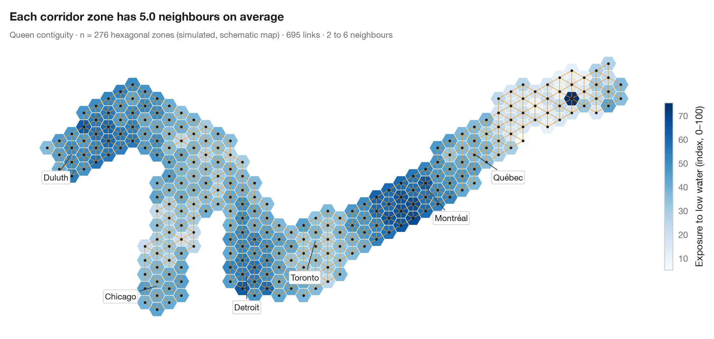
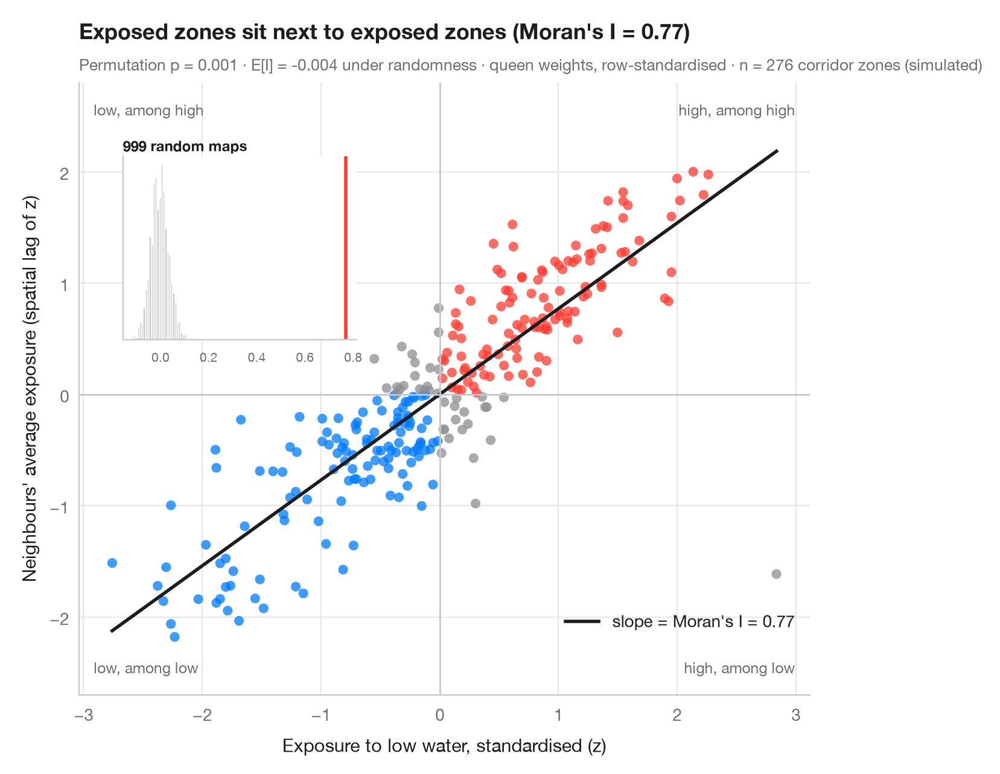
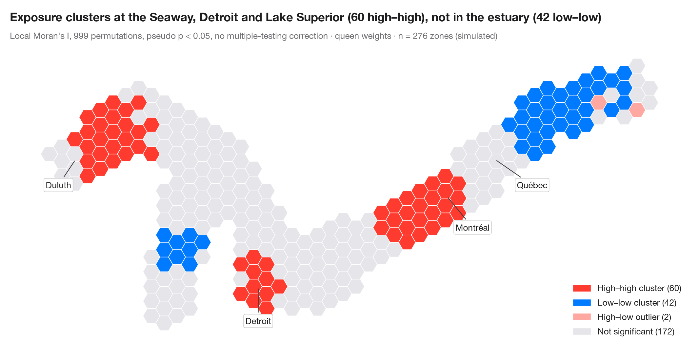
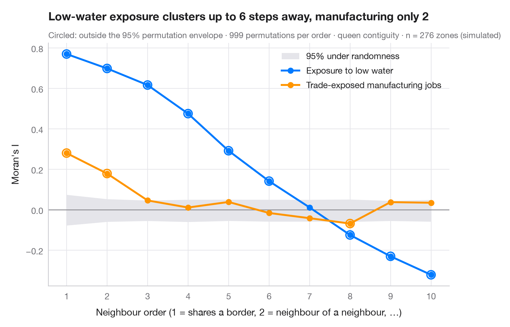

# Spatial data

Is a value higher where its neighbours' values are higher? Spatial weights, global and local spatial autocorrelation, and how far clusters reach — along a schematic Great Lakes–St. Lawrence corridor.

| Chart | Description |
|:--|:--|
|  | **[Choropleth with spatial weights](01-spatial-weights/)** A map of one variable with the neighbour network drawn on top — the structure every spatial statistic relies on. `spdep::poly2nb() + plot(nb, coords)` |
|  | **[Moran scatterplot (global autocorrelation)](02-moran-scatterplot/)** Each area against the average of its neighbours, with Moran's I, its permutation test and the reference distribution. `spdep::moran.plot() + spdep::moran.mc()` |
|  | **[LISA cluster map (local autocorrelation)](03-lisa-cluster-map/)** Where the clusters and spatial outliers are — local Moran's I for each area, mapped with its permutation significance. `spdep::localmoran_perm() / rgeoda::local_moran()` |
|  | **[Spatial correlogram](04-spatial-correlogram/)** Moran's I at increasing neighbour orders, with a permutation envelope — how far spatial clustering reaches. `spdep::sp.correlogram(method = "I")` |

[← All families](../../README.md) · [Browse on the website](https://warint.github.io/pystatlas/spatial-data/)
